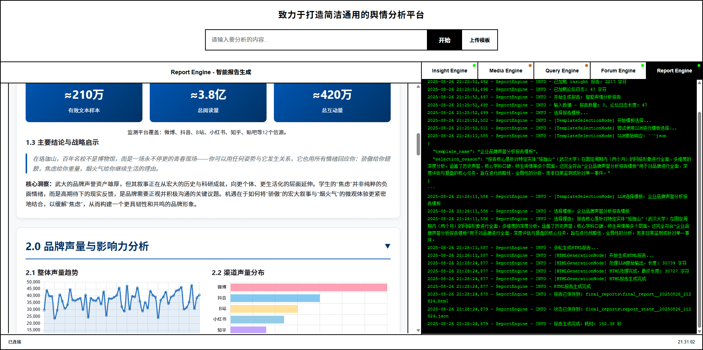
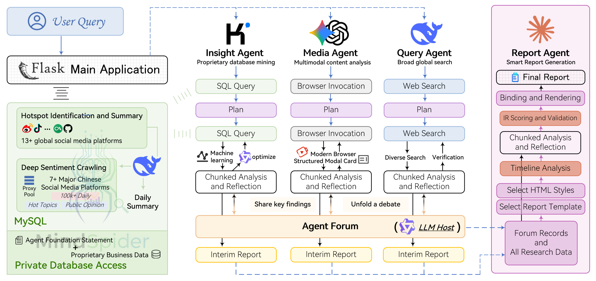

<div align="center">


<a href="https://trendshift.io/repositories/15286" target="_blank"></a>

<a href="https://aihubmix.com/?aff=8Ds9" target="_blank"></a>&ensp;
<a href="https://open.anspire.cn/?share_code=3E1FUOUH" target="_blank"></a>

[](https://github.com/666ghj/BettaFish/stargazers)
[](https://github.com/666ghj/BettaFish/watchers)
[](https://github.com/666ghj/BettaFish/network)
[](https://github.com/666ghj/BettaFish/issues)
[](https://github.com/666ghj/BettaFish/pulls)

[](https://github.com/666ghj/BettaFish/blob/main/LICENSE)
[](https://github.com/666ghj/BettaFish)
[](https://hub.docker.com/)


[English](./README-EN.md) | [Português](./README.md)

</div>

> [!NOTE]
> ### Fork BR/LATAM — Adaptado para o mercado brasileiro e latino-americano
>
> | Documento | Descrição |
> |-----------|-----------|
> | [Relatório Completo do Projeto](./RELATORIO_PROJETO.md) | Tudo sobre o que foi feito, arquitetura, configuração, uso e plano de evolução |
> | [Configuração Rápida](#%EF%B8%8F-infraestrutura-para-deploy) | Como subir o sistema com Docker + Ollama |
> | [.env.example](./.env.example) | Modelo de configuração com todas as variáveis documentadas |
>
> **Destaques desta versão:**
> - Interface, logs e prompts 100% em português
> - Busca web global via Tavily (substituindo APIs chinesas)
> - 24 fontes de notícias RSS (Brasil, EUA, Europa, América do Sul)
> - Análise de sentimento multilíngue com suporte nativo a português
> - Docker local com Ollama (sem dependência de APIs pagas de LLM)

> [!IMPORTANT]
> Confira nosso motor de previsão recém-lançado: [MiroFish - Motor de inteligência coletiva simples e universal para prever tudo](https://github.com/666ghj/MiroFish)
>
> 
>
> "Os três pilares da análise de dados" estão totalmente integrados: temos a alegria de anunciar o lançamento oficial do MiroFish! Com a última peça do quebra-cabeça encaixada, construímos o fluxo completo do BettaFish (coleta e análise de dados) ao MiroFish (previsão panorâmica). Assim, o ciclo completo dos dados brutos à tomada de decisão inteligente está concluído, tornando possível prever o futuro!

## ⚡ Visão Geral do Projeto

"**WeiYu**" (Micro-Opinião) é um sistema inovador de análise de opinião pública baseado em multi-agentes, desenvolvido do zero, que ajuda os usuários a romper bolhas informacionais, restaurar o panorama real da opinião pública, prever tendências futuras e auxiliar na tomada de decisões. O usuário só precisa expressar sua necessidade de análise como em uma conversa, e os agentes iniciam automaticamente a análise de mais de 30 plataformas de mídia social nacionais e internacionais e de milhões de comentários do público.

> "WeiYu" é um trocadilho em chinês que soa como "peixinho". BettaFish é um peixe de corpo muito pequeno, mas extremamente combativo e bonito, simbolizando "pequeno mas poderoso, sem medo de desafios"

Veja o relatório de pesquisa gerado pelo sistema usando "opinião pública da Universidade de Wuhan" como exemplo: [Relatório de Análise Aprofundada da Reputação da Marca da Universidade de Wuhan](./final_reports/final_report__20250827_131630.html)

Veja o vídeo de uma execução completa do sistema usando "opinião pública da Universidade de Wuhan" como exemplo: [Vídeo - Relatório de Análise Aprofundada da Reputação da Marca da Universidade de Wuhan](https://www.bilibili.com/video/BV1TH1WBxEWN/?vd_source=da3512187e242ce17dceee4c537ec7a6#reply279744466833)

Não apenas na qualidade dos relatórios, mas em comparação com produtos similares, possuímos 6 grandes vantagens:

1. **Monitoramento Global Impulsionado por IA**: Clusters de crawlers de IA operando 24/7, cobrindo integralmente mais de 10 plataformas de mídia social nacionais e internacionais como Weibo, Xiaohongshu, Douyin, Kuaishou, etc. Além de capturar conteúdo em alta em tempo real, consegue aprofundar-se em comentários massivos de usuários, permitindo ouvir a voz mais autêntica e abrangente do público.

2. **Motor de Análise Composto que Vai Além dos LLMs**: Não dependemos apenas dos 5 tipos de Agents profissionais projetados, mas também integramos middlewares como modelos ajustados finamente e modelos estatísticos. Através da colaboração multi-modelo, garantimos profundidade, precisão e perspectivas multidimensionais nos resultados da análise.

3. **Poderosa Capacidade Multimodal**: Rompendo as limitações de texto e imagem, consegue analisar em profundidade conteúdo de vídeos curtos do Douyin, Kuaishou, entre outros, e extrair com precisão cartões de informação multimodal estruturada como clima, calendário e ações de motores de busca modernos, permitindo domínio completo das dinâmicas de opinião pública.

4. **Mecanismo de Colaboração "Fórum" entre Agents**: Atribuindo a cada Agent um conjunto único de ferramentas e modos de pensamento, introduzimos um modelo de moderador de debates, permitindo colisão e debate de cadeias de pensamento através do mecanismo de "Fórum". Isso não apenas evita limitações de pensamento de um único modelo e a homogeneização causada pela comunicação, mas também gera inteligência coletiva e suporte à decisão de maior qualidade.

5. **Integração Perfeita de Dados Públicos e Privados**: A plataforma não apenas analisa a opinião pública aberta, mas também fornece interfaces de alta segurança, permitindo integrar perfeitamente bancos de dados internos de negócios com dados de opinião pública. Quebrando barreiras de dados, oferece poderosa capacidade de análise de "tendências externas + insights internos" para negócios verticais.

6. **Framework Leve e Altamente Extensível**: Baseado em design modular em Python puro, alcança implantação leve e com um único clique. A estrutura do código é clara, e desenvolvedores podem facilmente integrar modelos personalizados e lógica de negócios, permitindo expansão rápida e personalização profunda da plataforma.

**Começa pela opinião pública, mas não se limita a ela**. O objetivo do "WeiYu" é tornar-se um motor de análise de dados simples e universal que impulsiona qualquer cenário de negócio.

> Por exemplo, você só precisa modificar os parâmetros de API e prompts do conjunto de ferramentas do Agent para transformá-lo em um sistema de análise de mercado no setor financeiro
>
> Segue um tópico de discussão bastante ativo no fórum L: https://linux.do/t/topic/1009280
>
> Veja a avaliação feita por um membro do fórum L [Comparação do projeto open source (WeiYu) com manus|minimax|ChatGPT|Perplexity](https://linux.do/t/topic/1148040)

<div align="center">


Diga adeus aos painéis de dados tradicionais. No "WeiYu", tudo começa com uma simples pergunta - você só precisa expressar sua necessidade de análise como em uma conversa
</div>

## 🪄 Patrocinadores

Patrocínio de API de modelos LLM: <a href="https://aihubmix.com/?aff=8Ds9" target="_blank"></a>

<details>
<summary>Provedor de capacidades centrais de agentes inteligentes como busca conectada por IA, análise de arquivos e captura de conteúdo web:</a><span style="margin-left: 10px"><a href="https://open.anspire.cn/?share_code=3E1FUOUH" target="_blank"></a></summary>
A Plataforma Aberta Anspire (Anspire Open) é um provedor líder de infraestrutura para a era dos agentes inteligentes. Oferecemos aos desenvolvedores a pilha de capacidades centrais necessárias para construir agentes poderosos, com serviços já disponíveis como busca conectada por IA [múltiplas versões, preços extremamente competitivos], análise de arquivos [gratuita por tempo limitado] e captura de conteúdo web [gratuita por tempo limitado], automação de navegador em nuvem (Anspire Browser Agent) [em beta], reescrita em múltiplas rodadas e mais, fornecendo continuamente uma base sólida para que agentes inteligentes se conectem e operem no complexo mundo digital. Integração perfeita com plataformas de agentes populares como Dify, Coze, Yuanqi, entre outras. Através de um sistema de cobrança transparente por pontos e design modular, oferecemos suporte personalizado eficiente e de baixo custo para empresas, acelerando o processo de modernização inteligente.
</details>

## 🏗️ Arquitetura do Sistema

### Diagrama da Arquitetura Geral

**Insight Agent** Mineração de banco de dados privado: Agente de IA para análise aprofundada de bancos de dados privados de opinião pública

**Media Agent** Análise de conteúdo multimodal: Agente de IA com poderosas capacidades multimodais

**Query Agent** Busca precisa de informações: Agente de IA com capacidade de busca web nacional e internacional

**Report Agent** Geração inteligente de relatórios: Agente de IA para geração de relatórios em múltiplas rodadas com templates integrados

<div align="center">

</div>

### Fluxo Completo de Uma Análise

| Etapa | Nome da Fase | Operação Principal | Componentes Envolvidos | Características de Loop |
|------|----------|----------|----------|----------|
| 1 | Pergunta do Usuário | Aplicação principal Flask recebe a consulta | Aplicação principal Flask | - |
| 2 | Inicialização Paralela | Três Agents começam a trabalhar simultaneamente | Query Agent, Media Agent, Insight Agent | - |
| 3 | Análise Preliminar | Cada Agent usa suas ferramentas exclusivas para busca geral | Cada Agent + conjunto de ferramentas exclusivo | - |
| 4 | Formulação de Estratégia | Formulação de estratégia de pesquisa segmentada com base nos resultados preliminares | Módulo de decisão interno de cada Agent | - |
| 5-N | **Fase de Loop** | **Colaboração no Fórum + Pesquisa Aprofundada** | **ForumEngine + Todos os Agents** | **Loop em múltiplas rodadas** |
| 5.1 | Pesquisa Aprofundada | Cada Agent realiza busca especializada guiado pelo moderador do fórum | Cada Agent + mecanismo de reflexão + orientação do fórum | Cada rodada do loop |
| 5.2 | Colaboração no Fórum | ForumEngine monitora falas dos Agents e gera orientação do moderador | ForumEngine + LLM moderador | Cada rodada do loop |
| 5.3 | Troca e Fusão | Cada Agent ajusta sua direção de pesquisa com base na discussão | Cada Agent + ferramenta forum_reader | Cada rodada do loop |
| N+1 | Integração de Resultados | Report Agent coleta todos os resultados de análise e conteúdo do fórum | Report Agent | - |
| N+2 | Representação Intermediária IR | Seleção dinâmica de template e estilo, geração de metadados em múltiplas rodadas, montagem em representação intermediária IR | Report Agent + motor de templates | - |
| N+3 | Geração do Relatório | Verificação de qualidade por blocos, renderização em relatório HTML interativo baseado em IR | Report Agent + motor de montagem | - |

### Estrutura de Código do Projeto

```
BettaFish/
├── QueryEngine/                            # Agent de busca ampla de notícias nacionais e internacionais
│   ├── agent.py                            # Lógica principal do Agent, coordena fluxo de busca e análise
│   ├── llms/                               # Encapsulamento de interface LLM
│   ├── nodes/                              # Nós de processamento: busca, formatação, resumo, etc.
│   ├── tools/                              # Conjunto de ferramentas de busca de notícias nacionais e internacionais
│   ├── utils/                              # Funções utilitárias
│   ├── state/                              # Gerenciamento de estado
│   ├── prompts/                            # Templates de prompts
│   └── ...
├── MediaEngine/                            # Agent de compreensão multimodal poderoso
│   ├── agent.py                            # Lógica principal do Agent, processa conteúdo multimodal como vídeo/imagem
│   ├── llms/                               # Encapsulamento de interface LLM
│   ├── nodes/                              # Nós de processamento: busca, formatação, resumo, etc.
│   ├── tools/                              # Conjunto de ferramentas de busca multimodal
│   ├── utils/                              # Funções utilitárias
│   ├── state/                              # Gerenciamento de estado
│   ├── prompts/                            # Templates de prompts
│   └── ...
├── InsightEngine/                          # Agent de mineração de banco de dados privado
│   ├── agent.py                            # Lógica principal do Agent, coordena consulta e análise do banco de dados
│   ├── llms/                               # Encapsulamento de interface LLM
│   │   └── base.py                         # Cliente unificado compatível com OpenAI
│   ├── nodes/                              # Nós de processamento: busca, formatação, resumo, etc.
│   │   ├── base_node.py                    # Classe base de nó
│   │   ├── search_node.py                  # Nó de busca
│   │   ├── formatting_node.py              # Nó de formatação
│   │   ├── report_structure_node.py        # Nó de estrutura de relatório
│   │   └── summary_node.py                 # Nó de resumo
│   ├── tools/                              # Conjunto de ferramentas de consulta e análise de banco de dados
│   │   ├── keyword_optimizer.py            # Middleware de otimização de palavras-chave Qwen
│   │   ├── search.py                       # Conjunto de ferramentas de operação de banco de dados (busca de tópicos, obtenção de comentários, etc.)
│   │   └── sentiment_analyzer.py           # Ferramenta integrada de análise de sentimento
│   ├── utils/                              # Funções utilitárias
│   │   ├── config.py                       # Gerenciamento de configuração
│   │   ├── db.py                           # Motor assíncrono SQLAlchemy e encapsulamento de consulta somente leitura
│   │   └── text_processing.py              # Ferramentas de processamento de texto
│   ├── state/                              # Gerenciamento de estado
│   │   └── state.py                        # Definição de estado do Agent
│   ├── prompts/                            # Templates de prompts
│   │   └── prompts.py                      # Diversos prompts
│   └── __init__.py
├── ReportEngine/                           # Agent de geração de relatórios em múltiplas rodadas
│   ├── agent.py                            # Orquestrador geral: seleção de template→layout→extensão→capítulos→renderização
│   ├── flask_interface.py                  # Entrada Flask/SSE, gerencia fila de tarefas e eventos de streaming
│   ├── llms/                               # Encapsulamento de LLM compatível com OpenAI
│   │   └── base.py                         # Cliente unificado com streaming/retry
│   ├── core/                               # Funcionalidades centrais: parsing de template, armazenamento de capítulos, montagem de documento
│   │   ├── template_parser.py              # Fatiamento de template Markdown e geração de slug
│   │   ├── chapter_storage.py              # Diretório run de capítulos, manifest e escrita de fluxo raw
│   │   └── stitcher.py                     # Montador de Document IR, preenchimento de âncoras/metadados
│   ├── ir/                                 # Contrato e validação de Representação Intermediária (IR) do relatório
│   │   ├── schema.py                       # Definição de constantes de Schema de blocos/marcadores
│   │   └── validator.py                    # Validador de estrutura JSON de capítulos
│   ├── nodes/                              # Nós de inferência do fluxo completo
│   │   ├── base_node.py                    # Classe base de nó + hooks de log/estado
│   │   ├── template_selection_node.py      # Coleta de candidatos de template e seleção por LLM
│   │   ├── document_layout_node.py         # Design de título/índice/tema
│   │   ├── word_budget_node.py             # Planejamento de extensão e geração de instruções por capítulo
│   │   └── chapter_generation_node.py      # Geração JSON por capítulo + validação
│   ├── prompts/                            # Biblioteca de prompts e descrições de Schema
│   │   └── prompts.py                      # Prompts de seleção de template/layout/extensão/capítulo
│   ├── renderers/                          # Renderizadores de IR
│   │   ├── html_renderer.py               # Document IR→HTML interativo
│   │   ├── pdf_renderer.py                # HTML→exportação PDF (WeasyPrint)
│   │   ├── pdf_layout_optimizer.py         # Otimizador de layout PDF
│   │   └── chart_to_svg.py                # Ferramenta de conversão de gráficos para SVG
│   ├── state/                              # Modelos de estado de tarefa/metadados
│   │   └── state.py                        # ReportState e ferramentas de serialização
│   ├── utils/                              # Configuração e ferramentas auxiliares
│   │   ├── config.py                       # Pydantic Settings e auxiliar de impressão
│   │   ├── dependency_check.py             # Ferramenta de verificação de dependências
│   │   ├── json_parser.py                  # Ferramenta de parsing JSON
│   │   ├── chart_validator.py              # Ferramenta de validação de gráficos
│   │   └── chart_repair_api.py             # API de reparo de gráficos
│   ├── report_template/                    # Biblioteca de templates Markdown
│   │   ├── 企业品牌声誉分析报告.md
│   │   └── ...
│   └── __init__.py
├── ForumEngine/                            # Motor de fórum: mecanismo de colaboração entre Agents
│   ├── monitor.py                          # Núcleo de monitoramento de logs e gerenciamento do fórum
│   ├── llm_host.py                         # Módulo LLM do moderador do fórum
│   └── __init__.py
├── MindSpider/                             # Sistema de crawlers de mídias sociais
│   ├── main.py                             # Ponto de entrada principal do crawler
│   ├── config.py                           # Arquivo de configuração do crawler
│   ├── BroadTopicExtraction/               # Módulo de extração de tópicos
│   │   ├── main.py                         # Programa principal de extração de tópicos
│   │   ├── database_manager.py             # Gerenciador de banco de dados
│   │   ├── get_today_news.py               # Obtenção de notícias do dia
│   │   └── topic_extractor.py              # Extrator de tópicos
│   ├── DeepSentimentCrawling/              # Módulo de crawling profundo de opinião pública
│   │   ├── main.py                         # Programa principal de crawling profundo
│   │   ├── keyword_manager.py              # Gerenciador de palavras-chave
│   │   ├── platform_crawler.py             # Gerenciador de crawlers por plataforma
│   │   └── MediaCrawler/                   # Núcleo de crawlers de mídias sociais
│   │       ├── main.py
│   │       ├── config/                     # Configurações por plataforma
│   │       ├── media_platform/             # Implementação de crawlers por plataforma
│   │       └── ...
│   └── schema/                             # Definição de estrutura do banco de dados
│       ├── db_manager.py                   # Gerenciador de banco de dados
│       ├── init_database.py                # Script de inicialização do banco de dados
│       ├── mindspider_tables.sql           # SQL da estrutura de tabelas do banco de dados
│       ├── models_bigdata.py               # Mapeamento SQLAlchemy das tabelas de opinião pública em larga escala
│       └── models_sa.py                    # Modelos ORM de tabelas estendidas DailyTopic/Task
├── SentimentAnalysisModel/                 # Coleção de modelos de análise de sentimento
│   ├── WeiboSentiment_Finetuned/           # Modelos BERT/GPT-2 ajustados finamente
│   │   ├── BertChinese-Lora/               # Ajuste fino LoRA do BERT chinês
│   │   │   ├── train.py
│   │   │   ├── predict.py
│   │   │   └── ...
│   │   └── GPT2-Lora/                      # Ajuste fino LoRA do GPT-2
│   │       ├── train.py
│   │       ├── predict.py
│   │       └── ...
│   ├── WeiboMultilingualSentiment/         # Análise de sentimento multilíngue
│   │   ├── train.py
│   │   ├── predict.py
│   │   └── ...
│   ├── WeiboSentiment_SmallQwen/           # Ajuste fino do Qwen3 com poucos parâmetros
│   │   ├── train.py
│   │   ├── predict_universal.py
│   │   └── ...
│   └── WeiboSentiment_MachineLearning/     # Métodos tradicionais de aprendizado de máquina
│       ├── train.py
│       ├── predict.py
│       └── ...
├── SingleEngineApp/                        # Aplicações Streamlit de Agents individuais
│   ├── query_engine_streamlit_app.py       # Aplicação independente do QueryEngine
│   ├── media_engine_streamlit_app.py       # Aplicação independente do MediaEngine
│   └── insight_engine_streamlit_app.py     # Aplicação independente do InsightEngine
├── query_engine_streamlit_reports/         # Saída da aplicação individual do QueryEngine
├── media_engine_streamlit_reports/         # Saída da aplicação individual do MediaEngine
├── insight_engine_streamlit_reports/       # Saída da aplicação individual do InsightEngine
├── templates/                              # Templates do frontend Flask
│   └── index.html                          # HTML da interface principal
├── static/                                 # Recursos estáticos
│   ├── image/                              # Recursos de imagem
│   │   └── ...
│   ├── Partial README for PDF Exporting/   # Instruções de configuração de dependências para exportação PDF
│   └── v2_report_example/                  # Exemplos de renderização de relatórios
│       └── report_all_blocks_demo/         # Demonstração de todos os tipos de blocos (HTML/PDF/MD)
├── logs/                                   # Diretório de logs de execução
├── final_reports/                          # Arquivos de relatórios finais gerados
│   ├── ir/                                 # Arquivos JSON de IR do relatório
│   └── *.html                              # Relatórios HTML finais
├── utils/                                  # Funções utilitárias gerais
│   ├── forum_reader.py                     # Ferramenta de comunicação do fórum entre Agents
│   ├── github_issues.py                    # Geração unificada de links para GitHub Issues e mensagens de erro
│   └── retry_helper.py                     # Ferramenta de mecanismo de retry para requisições de rede
├── tests/                                  # Testes unitários e de integração
│   ├── run_tests.py                        # Script de entrada do pytest
│   ├── test_monitor.py                     # Testes unitários do monitoramento do ForumEngine
│   ├── test_report_engine_sanitization.py  # Testes de segurança do ReportEngine
│   └── ...
├── app.py                                  # Ponto de entrada da aplicação Flask principal
├── config.py                               # Arquivo de configuração global
├── .env.example                            # Arquivo de exemplo de variáveis de ambiente
├── docker-compose.yml                      # Configuração de orquestração multi-serviço Docker
├── Dockerfile                              # Arquivo de construção de imagem Docker
├── requirements.txt                        # Lista de dependências Python
├── regenerate_latest_html.py               # Remontagem e renderização HTML usando os capítulos mais recentes
├── regenerate_latest_md.py                 # Remontagem e renderização Markdown usando os capítulos mais recentes
├── regenerate_latest_pdf.py                # Script de regeneração de PDF
├── report_engine_only.py                   # Versão de linha de comando do Report Engine
├── README.md                               # Documentação em português
├── README-EN.md                            # Documentação em inglês
├── CONTRIBUTING.md                         # Guia de contribuição em chinês
├── CONTRIBUTING-EN.md                      # Guia de contribuição em inglês
└── LICENSE                                 # Licença open source GPL-2.0
```

## 🚀 Início Rápido (Docker)

### 1. Iniciar o projeto

Copie o arquivo `.env.example`, renomeie-o para `.env` e configure as variáveis de ambiente no arquivo `.env` conforme necessário

Execute o seguinte comando para iniciar todos os serviços em segundo plano:

```bash
docker compose up -d
```

> **Nota: se o download da imagem estiver lento**, no arquivo `docker-compose.yml` original, já fornecemos endereços de imagem alternativos por meio de **comentários** para sua substituição

### 2. Instruções de Configuração

#### Configuração do Banco de Dados (PostgreSQL)

Configure as informações de conexão com o banco de dados de acordo com os seguintes parâmetros. MySQL também é suportado e pode ser modificado por conta própria:

| Item de Configuração | Valor | Descrição |
| :--- | :--- | :--- |
| `DB_HOST` | `db` | Nome do serviço de banco de dados (corresponde ao nome do serviço no `docker-compose.yml`) |
| `DB_PORT` | `5432` | Porta padrão do PostgreSQL |
| `DB_USER` | `bettafish` | Nome de usuário do banco de dados |
| `DB_PASSWORD` | `bettafish` | Senha do banco de dados |
| `DB_NAME` | `bettafish` | Nome do banco de dados |
| **Outros** | **Manter padrão** | Pool de conexões e outros parâmetros do banco de dados devem manter as configurações padrão. |

#### Configuração de Modelos de Linguagem

> Todas as nossas chamadas de LLM utilizam o padrão de interface API da OpenAI

Após concluir a configuração do banco de dados, configure normalmente **todos os parâmetros relacionados ao modelo de linguagem**, garantindo que o sistema possa se conectar ao serviço de modelo de linguagem escolhido.

Após concluir todas as configurações acima e salvar, o sistema estará pronto para funcionar.

## 🔧 Guia de Inicialização a Partir do Código-Fonte

> Se você está aprendendo pela primeira vez como construir um sistema de Agents, pode começar com um demo muito simples: [Deep Search Agent Demo](https://github.com/666ghj/DeepSearchAgent-Demo)

### Requisitos do Ambiente

- **Sistema Operacional**: Windows, Linux, MacOS
- **Versão do Python**: 3.9+
- **Conda**: Anaconda ou Miniconda
- **Banco de Dados**: PostgreSQL (recomendado) ou MySQL
- **Memória**: Recomendado 2GB ou mais

### 1. Criar Ambiente

#### Se usar Conda

```bash
# Criar ambiente conda
conda create -n your_conda_name python=3.11
conda activate your_conda_name
```

#### Se usar uv

```bash
# Criar ambiente uv
uv venv --python 3.11 # Criar ambiente 3.11
```

### 2. Instalar Dependências do Sistema para Exportação PDF (Opcional)

Há instruções detalhadas de configuração nesta parte: [Configurar dependências necessárias](./static/Partial%20README%20for%20PDF%20Exporting/README.md)

### 3. Instalar Pacotes de Dependências

> Se você pulou a etapa 2, a biblioteca weasyprint pode não ser instalada e a funcionalidade de PDF pode não funcionar corretamente.

```bash
# Instalação de dependências básicas
pip install -r requirements.txt

# Comando para versão uv (instalação mais rápida)
uv pip install -r requirements.txt
# Se não quiser usar o modelo local de análise de sentimento (necessidade computacional muito baixa, versão CPU instalada por padrão), você pode comentar a seção "aprendizado de máquina" neste arquivo antes de executar o comando
```

### 4. Instalar Driver de Navegador Playwright

```bash
# Instalar driver de navegador (usado para funcionalidade de crawler)
playwright install chromium
```

### 5. Configurar LLM e Banco de Dados

Copie o arquivo `.env.example` do diretório raiz do projeto e renomeie-o para `.env`

Edite o arquivo `.env` e insira suas chaves de API (você também pode escolher seus próprios modelos e proxies de busca, veja detalhes no arquivo .env.example do diretório raiz ou nas instruções em config.py do diretório raiz):

```yml
# ====================== Configuração do Banco de Dados ======================
# Host do banco de dados, por exemplo localhost ou 127.0.0.1
DB_HOST=your_db_host
# Porta do banco de dados, padrão 3306
DB_PORT=3306
# Nome de usuário do banco de dados
DB_USER=your_db_user
# Senha do banco de dados
DB_PASSWORD=your_db_password
# Nome do banco de dados
DB_NAME=your_db_name
# Charset do banco de dados, recomendado utf8mb4, compatível com emoji
DB_CHARSET=utf8mb4
# Tipo de banco de dados: postgresql ou mysql
DB_DIALECT=postgresql
# O banco de dados não precisa de inicialização, será detectado automaticamente ao executar app.py

# ====================== Configuração do LLM ======================
# Você pode alterar a API de LLM usada em cada seção, qualquer uma compatível com o formato de requisição OpenAI funciona
# O arquivo de configuração fornece o LLM recomendado para cada Agent, na primeira implantação consulte as configurações recomendadas

# Insight Agent
INSIGHT_ENGINE_API_KEY=
INSIGHT_ENGINE_BASE_URL=
INSIGHT_ENGINE_MODEL_NAME=

# Media Agent
...
```

### 6. Iniciar o Sistema

#### 6.1 Inicialização do Sistema Completo (Recomendado)

```bash
# No diretório raiz do projeto, ative o ambiente conda
conda activate your_conda_name

# Inicie a aplicação principal
python app.py
```

Comando de inicialização para versão uv
```bash
# No diretório raiz do projeto, ative o ambiente uv
.venv\Scripts\activate

# Inicie a aplicação principal
python app.py
```

> Nota 1: Após o término de uma execução, o streamlit app pode encerrar de forma anormal e continuar ocupando a porta. Nesse caso, basta encontrar e encerrar o processo que está ocupando a porta

> Nota 2: A coleta de dados requer operação separada, veja as instruções em 6.3

Acesse http://localhost:5000 para utilizar o sistema completo

#### 6.2 Iniciar um Agent Individualmente

```bash
# Iniciar QueryEngine
streamlit run SingleEngineApp/query_engine_streamlit_app.py --server.port 8503

# Iniciar MediaEngine
streamlit run SingleEngineApp/media_engine_streamlit_app.py --server.port 8502

# Iniciar InsightEngine
streamlit run SingleEngineApp/insight_engine_streamlit_app.py --server.port 8501
```

#### 6.3 Uso Independente do Sistema de Crawlers

Há documentação detalhada de configuração nesta parte: [Instruções de uso do MindSpider](./MindSpider/README.md)

<div align="center">


Exemplo de execução do MindSpider
</div>

```bash
# Entrar no diretório do crawler
cd MindSpider

# Inicialização do projeto
python main.py --setup

# Executar extração de tópicos (obter notícias em alta e palavras-chave)
python main.py --broad-topic

# Executar fluxo completo do crawler
python main.py --complete --date 2024-01-20

# Executar apenas extração de tópicos
python main.py --broad-topic --date 2024-01-20

# Executar apenas crawling profundo
python main.py --deep-sentiment --platforms xhs dy wb
```

#### 6.4 Ferramenta de Geração de Relatório por Linha de Comando

Esta ferramenta pula a fase de execução dos três motores de análise, lê diretamente seus arquivos de log mais recentes e gera o relatório consolidado sem necessidade de interface web (também omite a etapa de verificação incremental de arquivos). Por padrão, gera automaticamente Markdown após o PDF (pode ser desativado por parâmetro). Geralmente usada em cenários onde o resultado da geração de relatório não é satisfatório e uma nova tentativa rápida é necessária, ou ao depurar o Report Engine.

```bash
# Uso básico (extrai automaticamente o tema do nome do arquivo)
python report_engine_only.py

# Especificar tema do relatório
python report_engine_only.py --query "Análise da indústria de engenharia civil"

# Pular geração de PDF (mesmo que o sistema suporte)
python report_engine_only.py --skip-pdf

# Pular geração de Markdown
python report_engine_only.py --skip-markdown

# Exibir logs detalhados
python report_engine_only.py --verbose

# Ver informações de ajuda
python report_engine_only.py --help
```

**Descrição das Funcionalidades:**

1. **Verificação automática de dependências**: O programa verifica automaticamente as dependências do sistema necessárias para geração de PDF e, se estiverem faltando, fornece instruções de instalação
2. **Obtenção dos arquivos mais recentes**: Obtém automaticamente os relatórios de análise mais recentes dos três diretórios de motores (`insight_engine_streamlit_reports`, `media_engine_streamlit_reports`, `query_engine_streamlit_reports`)
3. **Confirmação de arquivos**: Exibe todos os nomes de arquivo selecionados, caminhos e horários de modificação, aguardando confirmação do usuário (digite `y` para continuar por padrão, `n` para sair)
4. **Geração direta de relatório**: Pula o programa de revisão de incremento de arquivos e chama diretamente o Report Engine para gerar o relatório consolidado
5. **Salvamento automático de arquivos**:
   - Relatórios HTML salvos no diretório `final_reports/`
   - Relatórios PDF (se houver dependências) salvos no diretório `final_reports/pdf/`
   - Relatórios Markdown (pode ser desativado com `--skip-markdown`) salvos no diretório `final_reports/md/`
   - Formato de nomenclatura: `final_report_{tema}_{timestamp}.html/pdf/md`

**Observações:**

- Certifique-se de que pelo menos um dos três diretórios de motores contenha arquivos de relatório `.md`
- A ferramenta de linha de comando e a interface web são independentes entre si e não se afetam mutuamente
- A geração de PDF requer instalação de dependências do sistema, veja a seção "Instalar Dependências do Sistema para Exportação PDF" acima

**Re-renderização rápida dos resultados mais recentes:**

- `regenerate_latest_html.py` / `regenerate_latest_md.py`: Remonta o Document IR a partir dos JSONs de capítulo da execução mais recente em `CHAPTER_OUTPUT_DIR` e renderiza diretamente HTML ou Markdown.
- `regenerate_latest_pdf.py`: Lê o IR mais recente de `final_reports/ir` e re-exporta o PDF usando gráficos vetoriais SVG.

## ⚙️ Configuração Avançada (Obsoleta, já unificada no arquivo .env do diretório raiz do projeto; outros sub-agents herdam automaticamente a configuração do diretório raiz)

### Modificar Parâmetros-Chave

#### Parâmetros de Configuração dos Agents

Cada Agent possui um arquivo de configuração dedicado que pode ser ajustado conforme a necessidade. Seguem alguns exemplos:

```python
# QueryEngine/utils/config.py
class Config:
    max_reflections = 2           # Rodadas de reflexão
    max_search_results = 15       # Número máximo de resultados de busca
    max_content_length = 8000     # Comprimento máximo do conteúdo

# MediaEngine/utils/config.py
class Config:
    comprehensive_search_limit = 10  # Limite de busca abrangente
    web_search_limit = 15           # Limite de busca web

# InsightEngine/utils/config.py
class Config:
    default_search_topic_globally_limit = 200    # Limite de busca global
    default_get_comments_limit = 500             # Limite de obtenção de comentários
    max_search_results_for_llm = 50              # Número máximo de resultados passados ao LLM
```

#### Configuração do Modelo de Análise de Sentimento

```python
# InsightEngine/tools/sentiment_analyzer.py
SENTIMENT_CONFIG = {
    'model_type': 'multilingual',     # Opções: 'bert', 'multilingual', 'qwen', etc.
    'confidence_threshold': 0.8,      # Limiar de confiança
    'batch_size': 32,                 # Tamanho do lote
    'max_sequence_length': 512,       # Comprimento máximo da sequência
}
```

### Conectar Diferentes Modelos LLM

Suporta qualquer provedor de LLM no formato de chamada OpenAI. Basta preencher os campos KEY, BASE_URL e MODEL_NAME correspondentes em /config.py.

> O que é o formato de chamada OpenAI? Aqui está um exemplo simples:
>```python
>from openai import OpenAI
>
>client = OpenAI(api_key="your_api_key",
>                base_url="https://aihubmix.com/v1")
>
>response = client.chat.completions.create(
>    model="gpt-4o-mini",
>    messages=[
>        {'role': 'user',
>         'content': "Quais novas oportunidades os modelos de raciocínio trarão ao mercado"}
>    ],
>)
>
>complete_response = response.choices[0].message.content
>print(complete_response)
>```

### Alterar o Modelo de Análise de Sentimento

O sistema integra diversos métodos de análise de sentimento, que podem ser escolhidos conforme a necessidade:

#### 1. Análise de Sentimento Multilíngue

```bash
cd SentimentAnalysisModel/WeiboMultilingualSentiment
python predict.py --text "This product is amazing!" --lang "en"
```

#### 2. Ajuste Fino do Qwen3 com Poucos Parâmetros

```bash
cd SentimentAnalysisModel/WeiboSentiment_SmallQwen
python predict_universal.py --text "Este evento foi um grande sucesso"
```

#### 3. Modelo Ajustado Fino Baseado em BERT

```bash
# Usar modelo BERT chinês
cd SentimentAnalysisModel/WeiboSentiment_Finetuned/BertChinese-Lora
python predict.py --text "Este produto é realmente muito bom"
```

#### 4. Modelo Ajustado Fino GPT-2 LoRA

```bash
cd SentimentAnalysisModel/WeiboSentiment_Finetuned/GPT2-Lora
python predict.py --text "Hoje não estou me sentindo muito bem"
```

#### 5. Métodos Tradicionais de Aprendizado de Máquina

```bash
cd SentimentAnalysisModel/WeiboSentiment_MachineLearning
python predict.py --model_type "svm" --text "O atendimento precisa melhorar"
```

### Conectar Banco de Dados de Negócios Personalizado

#### 1. Modificar Configuração de Conexão com o Banco de Dados

```python
# Adicionar configuração do banco de dados de negócios em config.py
BUSINESS_DB_HOST = "your_business_db_host"
BUSINESS_DB_PORT = 3306
BUSINESS_DB_USER = "your_business_user"
BUSINESS_DB_PASSWORD = "your_business_password"
BUSINESS_DB_NAME = "your_business_database"
```

#### 2. Criar Ferramenta de Acesso a Dados Personalizada

```python
# InsightEngine/tools/custom_db_tool.py
class CustomBusinessDBTool:
    """Ferramenta de consulta a banco de dados de negócios personalizada"""

    def __init__(self):
        self.connection_config = {
            'host': config.BUSINESS_DB_HOST,
            'port': config.BUSINESS_DB_PORT,
            'user': config.BUSINESS_DB_USER,
            'password': config.BUSINESS_DB_PASSWORD,
            'database': config.BUSINESS_DB_NAME,
        }

    def search_business_data(self, query: str, table: str):
        """Consultar dados de negócios"""
        # Implemente sua lógica de negócios
        pass

    def get_customer_feedback(self, product_id: str):
        """Obter dados de feedback de clientes"""
        # Implemente a lógica de consulta de feedback de clientes
        pass
```

#### 3. Integrar ao InsightEngine

```python
# Integrar ferramenta personalizada em InsightEngine/agent.py
from .tools.custom_db_tool import CustomBusinessDBTool

class DeepSearchAgent:
    def __init__(self, config=None):
        # ... outro código de inicialização
        self.custom_db_tool = CustomBusinessDBTool()

    def execute_custom_search(self, query: str):
        """Executar busca personalizada de dados de negócios"""
        return self.custom_db_tool.search_business_data(query, "your_table")
```

### Personalizar Templates de Relatório

#### 1. Upload pela Interface Web

O sistema suporta upload de arquivos de template personalizados (formato .md ou .txt), que podem ser selecionados ao gerar relatórios.

#### 2. Criar Arquivo de Template

Crie novos templates no diretório `ReportEngine/report_template/`. Nosso Agent selecionará automaticamente o template mais adequado.

## 🤝 Guia de Contribuição

Aceitamos contribuições de todas as formas!

**Por favor, leia o seguinte guia de contribuição:**
- [CONTRIBUTING.md](./CONTRIBUTING.md)

## 🦖 Próximos Passos de Desenvolvimento

Agora o sistema completou a última etapa: previsão! Acesse e confira [MiroFish - Prever Tudo]: https://github.com/666ghj/MiroFish

<div align="center">


</div>

## ⚠️ Aviso Legal

**Aviso Importante: Este projeto destina-se exclusivamente a fins de estudo, pesquisa acadêmica e educação**

1. **Declaração de Conformidade**:
   - Todo o código, ferramentas e funcionalidades deste projeto destinam-se exclusivamente a fins de estudo, pesquisa acadêmica e educação
   - É estritamente proibido usar este projeto para qualquer finalidade comercial ou atividade lucrativa
   - É estritamente proibido usar este projeto para qualquer comportamento ilegal, irregular ou que viole os direitos de terceiros

2. **Isenção de Responsabilidade sobre Crawlers**:
   - As funcionalidades de crawler neste projeto destinam-se exclusivamente a fins de aprendizado técnico e pesquisa
   - Os usuários devem respeitar o protocolo robots.txt e os termos de uso dos sites-alvo
   - Os usuários devem cumprir as leis e regulamentos aplicáveis, não realizar coleta maliciosa ou uso indevido de dados
   - Quaisquer consequências legais decorrentes do uso das funcionalidades de crawler são de responsabilidade exclusiva do usuário

3. **Isenção de Responsabilidade sobre Uso de Dados**:
   - As funcionalidades de análise de dados do projeto destinam-se exclusivamente a pesquisa acadêmica
   - É estritamente proibido usar os resultados da análise para decisões comerciais ou fins lucrativos
   - Os usuários devem garantir a legalidade e conformidade dos dados analisados

4. **Isenção de Responsabilidade Técnica**:
   - Este projeto é fornecido "como está", sem qualquer garantia expressa ou implícita
   - Os autores não se responsabilizam por quaisquer perdas diretas ou indiretas causadas pelo uso deste projeto
   - Os usuários devem avaliar por conta própria a adequação e os riscos do projeto

5. **Limitação de Responsabilidade**:
   - Os usuários devem compreender plenamente as leis e regulamentos aplicáveis antes de usar este projeto
   - Os usuários devem garantir que seu uso esteja em conformidade com as leis e regulamentos locais
   - Quaisquer consequências decorrentes do uso deste projeto em violação de leis e regulamentos são de responsabilidade exclusiva do usuário

**Por favor, leia e compreenda cuidadosamente o aviso legal acima antes de usar este projeto. O uso deste projeto indica que você concorda e aceita todos os termos acima.**

## 📄 Licença

Este projeto é licenciado sob a [Licença GPL-2.0](LICENSE). Para informações detalhadas, consulte o arquivo LICENSE.

## 🎉 Suporte e Contato

### Obter Ajuda

Perguntas frequentes: https://github.com/666ghj/BettaFish/issues/185

- **Página do Projeto**: [Repositório GitHub](https://github.com/666ghj/BettaFish)
- **Reportar Problemas**: [Página de Issues](https://github.com/666ghj/BettaFish/issues)
- **Sugestões de Funcionalidades**: [Página de Discussions](https://github.com/666ghj/BettaFish/discussions)

### Informações de Contato

- **E-mail**: hangjiang@bupt.edu.cn

### Cooperação Empresarial

- **Desenvolvimento personalizado para empresas**
- **Serviços de Big Data**
- **Cooperação acadêmica**
- **Treinamento técnico**

## 👥 Contribuidores

Agradecemos aos seguintes excelentes contribuidores:

[](https://github.com/666ghj/BettaFish/graphs/contributors)

## 🌟 Junte-se ao Grupo Oficial de Comunicação

<div align="center">
  
  
</div>

## 🖥️ Infraestrutura para Deploy

### Opção Recomendada: Docker Compose

```bash
docker compose up -d
```

Sobe dois containers: a **aplicação** + **PostgreSQL 15**.

### Servidor Mínimo

| Recurso | Mínimo | Recomendado |
|---------|--------|-------------|
| RAM | 2 GB | 4 GB+ |
| Disco | 5 GB | 10 GB+ |
| CPU | 2 cores | 4+ cores |
| Python | 3.9+ | 3.11 |
| SO | Linux/macOS/Windows | Linux (Ubuntu) |

### Portas Expostas

| Porta | Serviço |
|-------|---------|
| 5000 | Flask (app principal) |
| 8501 | InsightEngine (Streamlit) |
| 8502 | MediaEngine (Streamlit) |
| 8503 | QueryEngine (Streamlit) |
| 5444 | PostgreSQL |

### Banco de Dados

- **PostgreSQL 15+** (recomendado) ou MySQL 8.0+
- Inicializado automaticamente no primeiro `python app.py`

### APIs Externas (LLMs + Buscadores)

O sistema usa 6 endpoints de LLM separados, cada um otimizado para sua função:

| Serviço | Função | Modelo Recomendado | Por que um modelo separado? |
|---------|--------|--------------------|-----------------------------|
| Moonshot Kimi | Insight Engine | kimi-k2 | Contexto longo para analisar grandes volumes de dados |
| Gemini 2.5 Pro | Media + Report Engine | gemini-2.5-pro | Multimodal (entende imagens e vídeos) |
| DeepSeek | Query Engine | deepseek-chat | Rápido e barato para muitas buscas web |
| Qwen | Forum Host + Keyword Optimizer | qwen-plus | Tarefas leves de moderação e otimização de queries |

Buscadores web (pelo menos um obrigatório):

| Serviço | Tipo |
|---------|------|
| Tavily | Busca web |
| Anspire | Busca IA |
| Bocha | Busca IA (alternativa) |

> **Posso usar apenas uma LLM?** Sim! Todas as APIs usam formato OpenAI-compatible. Você pode apontar todas as 6 variáveis no `.env` para o **mesmo modelo** (ex: GPT-4o, Claude ou Gemini), basta repetir a mesma chave/URL/modelo. A separação existe para otimizar **custo e desempenho** — modelos baratos onde pode, modelos fortes onde precisa — mas funciona perfeitamente com um só.

### Configuração

1. Copiar `.env.example` para `.env`
2. Preencher as **6 chaves de API** dos LLMs (ou a mesma chave repetida)
3. Preencher credenciais do banco de dados
4. Preencher chave de pelo menos um buscador (Tavily, Anspire ou Bocha)

### Deploy Nativo (sem Docker)

```bash
conda create -n bettafish python=3.11
conda activate bettafish
pip install -r requirements.txt
playwright install chromium
python app.py
```

## 💰 Custo por Relatório

Cada relatório consome ~620K tokens. Comparativo de custo e velocidade:

| Modelo | Custo/relatório | Tempo | 100 relatórios/mês |
|--------|----------------|-------|---------------------|
| Ollama local (qwen2.5:32b) | $0.00 | 3-4 horas | $0 |
| DeepSeek Chat | $0.11 | 8-12 min | ~$11 |
| GPT-4o-mini | $0.17 | 5-8 min | ~$17 |
| Claude Haiku 3.5 | $1.10 | 8-12 min | ~$110 |
| GPT-4o | $2.98 | 10-15 min | ~$298 |
| Claude Sonnet 4 | $4.14 | 10-15 min | ~$414 |

> Todos os modelos usam formato OpenAI-compatible. Basta trocar `API_KEY`, `BASE_URL` e `MODEL_NAME` no `.env`. Pode usar modelos diferentes por engine. Detalhes completos no [Relatório do Projeto](./RELATORIO_PROJETO.md#8-custo-de-tokens-e-comparativo-de-llms).

## 📈 Estatísticas do Projeto

<a href="https://www.star-history.com/#666ghj/BettaFish&type=date&legend=top-left">
 <picture>
   <source media="(prefers-color-scheme: dark)" srcset="https://api.star-history.com/svg?repos=666ghj/BettaFish&type=date&theme=dark&legend=top-left" />
   <source media="(prefers-color-scheme: light)" srcset="https://api.star-history.com/svg?repos=666ghj/BettaFish&type=date&legend=top-left" />
   
 </picture>
</a>


---

Projeto adaptado da comunidade ARCKHÉ TDS - Marca Arckhe