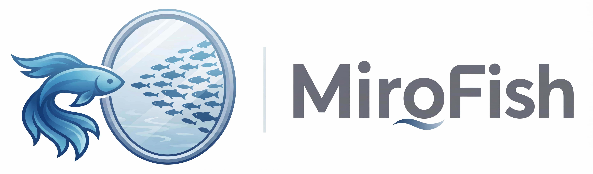
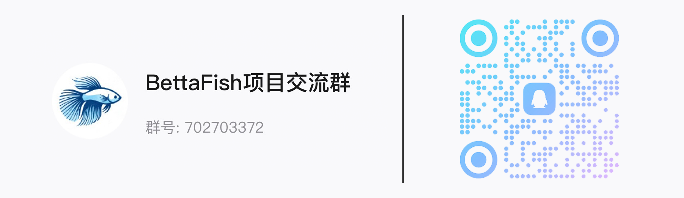

<div align="center">


<a href="https://trendshift.io/repositories/15286" target="_blank"></a>

<a href="https://aihubmix.com/?aff=8Ds9" target="_blank"></a>&ensp;
<a href="https://open.anspire.cn/?share_code=3E1FUOUH" target="_blank"></a>

[](https://github.com/666ghj/BettaFish/stargazers)
[](https://github.com/666ghj/BettaFish/watchers)
[](https://github.com/666ghj/BettaFish/network)
[](https://github.com/666ghj/BettaFish/issues)
[](https://github.com/666ghj/BettaFish/pulls)

[](https://github.com/666ghj/BettaFish/blob/main/LICENSE)
[](https://github.com/666ghj/BettaFish)
[](https://hub.docker.com/)


[English](./README-EN.md) | [PortuguêƒÂªs](./README.md)

</div>

> [!NOTE]
> ### Fork BR/LATAM ê¢â‚¬â€ Adaptado para o mercado brasileiro e latino-americano
>
> | Documento | DescriêƒÂ§êƒÂ£o |
> |-----------|-----------|
> | [RelatêƒÂ³rio Completo do Projeto](./RELATORIO_PROJETO.md) | Tudo sobre o que foi feito, arquitetura, configuraêƒÂ§êƒÂ£o, uso e plano de evoluêƒÂ§êƒÂ£o |
> | [ConfiguraêƒÂ§êƒÂ£o RêƒÂ¡pida](#%EF%B8%8F-infraestrutura-para-deploy) | Como subir o sistema com Docker + Ollama |
> | [.env.example](./.env.example) | Modelo de configuraêƒÂ§êƒÂ£o com todas as variêƒÂ¡veis documentadas |
>
> **Destaques desta versêƒÂ£o:**
> - Interface, logs e prompts 100% em portuguêƒÂªs
> - Busca web global via Tavily (substituindo APIs chinesas)
> - 24 fontes de notêƒÂ­cias RSS (Brasil, EUA, Europa, AmêƒÂ©rica do Sul)
> - AnêƒÂ¡lise de sentimento multilêƒÂ­ngue com suporte nativo a portuguêƒÂªs
> - Docker local com Ollama (sem dependêƒÂªncia de APIs pagas de LLM)

> [!IMPORTANT]
> Confira nosso motor de previsêƒÂ£o recêƒÂ©m-lanêƒÂ§ado: [MiroFish - Motor de inteligêƒÂªncia coletiva simples e universal para prever tudo](https://github.com/666ghj/MiroFish)
>
> 
>
> "Os trêƒÂªs pilares da anêƒÂ¡lise de dados" estêƒÂ£o totalmente integrados: temos a alegria de anunciar o lanêƒÂ§amento oficial do MiroFish! Com a êƒÂºltima peêƒÂ§a do quebra-cabeêƒÂ§a encaixada, construêƒÂ­mos o fluxo completo do BettaFish (coleta e anêƒÂ¡lise de dados) ao MiroFish (previsêƒÂ£o panorêƒÂ¢mica). Assim, o ciclo completo dos dados brutos êƒÂ  tomada de decisêƒÂ£o inteligente estêƒÂ¡ concluêƒÂ­do, tornando possêƒÂ­vel prever o futuro!

## ê¢Å¡Â¡ VisêƒÂ£o Geral do Projeto

"**WeiYu**" (Micro-OpiniêƒÂ£o) êƒÂ© um sistema inovador de anêƒÂ¡lise de opiniêƒÂ£o pêƒÂºblica baseado em multi-agentes, desenvolvido do zero, que ajuda os usuêƒÂ¡rios a romper bolhas informacionais, restaurar o panorama real da opiniêƒÂ£o pêƒÂºblica, prever tendêƒÂªncias futuras e auxiliar na tomada de decisêƒÂµes. O usuêƒÂ¡rio sêƒÂ³ precisa expressar sua necessidade de anêƒÂ¡lise como em uma conversa, e os agentes iniciam automaticamente a anêƒÂ¡lise de mais de 30 plataformas de mêƒÂ­dia social nacionais e internacionais e de milhêƒÂµes de comentêƒÂ¡rios do pêƒÂºblico.

> "WeiYu" êƒÂ© um trocadilho em chinêƒÂªs que soa como "peixinho". BettaFish êƒÂ© um peixe de corpo muito pequeno, mas extremamente combativo e bonito, simbolizando "pequeno mas poderoso, sem medo de desafios"

Veja o relatêƒÂ³rio de pesquisa gerado pelo sistema usando "opiniêƒÂ£o pêƒÂºblica da Universidade de Wuhan" como exemplo: [RelatêƒÂ³rio de AnêƒÂ¡lise Aprofundada da ReputaêƒÂ§êƒÂ£o da Marca da Universidade de Wuhan](./final_reports/final_report__20250827_131630.html)

Veja o vêƒÂ­deo de uma execuêƒÂ§êƒÂ£o completa do sistema usando "opiniêƒÂ£o pêƒÂºblica da Universidade de Wuhan" como exemplo: [VêƒÂ­deo - RelatêƒÂ³rio de AnêƒÂ¡lise Aprofundada da ReputaêƒÂ§êƒÂ£o da Marca da Universidade de Wuhan](https://www.bilibili.com/video/BV1TH1WBxEWN/?vd_source=da3512187e242ce17dceee4c537ec7a6#reply279744466833)

NêƒÂ£o apenas na qualidade dos relatêƒÂ³rios, mas em comparaêƒÂ§êƒÂ£o com produtos similares, possuêƒÂ­mos 6 grandes vantagens:

1. **Monitoramento Global Impulsionado por IA**: Clusters de crawlers de IA operando 24/7, cobrindo integralmente mais de 10 plataformas de mêƒÂ­dia social nacionais e internacionais como Weibo, Xiaohongshu, Douyin, Kuaishou, etc. AlêƒÂ©m de capturar conteêƒÂºdo em alta em tempo real, consegue aprofundar-se em comentêƒÂ¡rios massivos de usuêƒÂ¡rios, permitindo ouvir a voz mais autêƒÂªntica e abrangente do pêƒÂºblico.

2. **Motor de AnêƒÂ¡lise Composto que Vai AlêƒÂ©m dos LLMs**: NêƒÂ£o dependemos apenas dos 5 tipos de Agents profissionais projetados, mas tambêƒÂ©m integramos middlewares como modelos ajustados finamente e modelos estatêƒÂ­sticos. AtravêƒÂ©s da colaboraêƒÂ§êƒÂ£o multi-modelo, garantimos profundidade, precisêƒÂ£o e perspectivas multidimensionais nos resultados da anêƒÂ¡lise.

3. **Poderosa Capacidade Multimodal**: Rompendo as limitaêƒÂ§êƒÂµes de texto e imagem, consegue analisar em profundidade conteêƒÂºdo de vêƒÂ­deos curtos do Douyin, Kuaishou, entre outros, e extrair com precisêƒÂ£o cartêƒÂµes de informaêƒÂ§êƒÂ£o multimodal estruturada como clima, calendêƒÂ¡rio e aêƒÂ§êƒÂµes de motores de busca modernos, permitindo domêƒÂ­nio completo das dinêƒÂ¢micas de opiniêƒÂ£o pêƒÂºblica.

4. **Mecanismo de ColaboraêƒÂ§êƒÂ£o "FêƒÂ³rum" entre Agents**: Atribuindo a cada Agent um conjunto êƒÂºnico de ferramentas e modos de pensamento, introduzimos um modelo de moderador de debates, permitindo colisêƒÂ£o e debate de cadeias de pensamento atravêƒÂ©s do mecanismo de "FêƒÂ³rum". Isso nêƒÂ£o apenas evita limitaêƒÂ§êƒÂµes de pensamento de um êƒÂºnico modelo e a homogeneizaêƒÂ§êƒÂ£o causada pela comunicaêƒÂ§êƒÂ£o, mas tambêƒÂ©m gera inteligêƒÂªncia coletiva e suporte êƒÂ  decisêƒÂ£o de maior qualidade.

5. **IntegraêƒÂ§êƒÂ£o Perfeita de Dados PêƒÂºblicos e Privados**: A plataforma nêƒÂ£o apenas analisa a opiniêƒÂ£o pêƒÂºblica aberta, mas tambêƒÂ©m fornece interfaces de alta seguranêƒÂ§a, permitindo integrar perfeitamente bancos de dados internos de negêƒÂ³cios com dados de opiniêƒÂ£o pêƒÂºblica. Quebrando barreiras de dados, oferece poderosa capacidade de anêƒÂ¡lise de "tendêƒÂªncias externas + insights internos" para negêƒÂ³cios verticais.

6. **Framework Leve e Altamente ExtensêƒÂ­vel**: Baseado em design modular em Python puro, alcanêƒÂ§a implantaêƒÂ§êƒÂ£o leve e com um êƒÂºnico clique. A estrutura do cêƒÂ³digo êƒÂ© clara, e desenvolvedores podem facilmente integrar modelos personalizados e lêƒÂ³gica de negêƒÂ³cios, permitindo expansêƒÂ£o rêƒÂ¡pida e personalizaêƒÂ§êƒÂ£o profunda da plataforma.

**ComeêƒÂ§a pela opiniêƒÂ£o pêƒÂºblica, mas nêƒÂ£o se limita a ela**. O objetivo do "WeiYu" êƒÂ© tornar-se um motor de anêƒÂ¡lise de dados simples e universal que impulsiona qualquer cenêƒÂ¡rio de negêƒÂ³cio.

> Por exemplo, vocêƒÂª sêƒÂ³ precisa modificar os parêƒÂ¢metros de API e prompts do conjunto de ferramentas do Agent para transformêƒÂ¡-lo em um sistema de anêƒÂ¡lise de mercado no setor financeiro
>
> Segue um têƒÂ³pico de discussêƒÂ£o bastante ativo no fêƒÂ³rum L: https://linux.do/t/topic/1009280
>
> Veja a avaliaêƒÂ§êƒÂ£o feita por um membro do fêƒÂ³rum L [ComparaêƒÂ§êƒÂ£o do projeto open source (WeiYu) com manus|minimax|ChatGPT|Perplexity](https://linux.do/t/topic/1148040)

<div align="center">


Diga adeus aos painêƒÂ©is de dados tradicionais. No "WeiYu", tudo comeêƒÂ§a com uma simples pergunta - vocêƒÂª sêƒÂ³ precisa expressar sua necessidade de anêƒÂ¡lise como em uma conversa
</div>

## ê°Å¸Âªâ€ž Patrocinadores

PatrocêƒÂ­nio de API de modelos LLM: <a href="https://aihubmix.com/?aff=8Ds9" target="_blank"></a>

<details>
<summary>Provedor de capacidades centrais de agentes inteligentes como busca conectada por IA, anêƒÂ¡lise de arquivos e captura de conteêƒÂºdo web:</a><span style="margin-left: 10px"><a href="https://open.anspire.cn/?share_code=3E1FUOUH" target="_blank"></a></summary>
A Plataforma Aberta Anspire (Anspire Open) êƒÂ© um provedor lêƒÂ­der de infraestrutura para a era dos agentes inteligentes. Oferecemos aos desenvolvedores a pilha de capacidades centrais necessêƒÂ¡rias para construir agentes poderosos, com serviêƒÂ§os jêƒÂ¡ disponêƒÂ­veis como busca conectada por IA [mêƒÂºltiplas versêƒÂµes, preêƒÂ§os extremamente competitivos], anêƒÂ¡lise de arquivos [gratuita por tempo limitado] e captura de conteêƒÂºdo web [gratuita por tempo limitado], automaêƒÂ§êƒÂ£o de navegador em nuvem (Anspire Browser Agent) [em beta], reescrita em mêƒÂºltiplas rodadas e mais, fornecendo continuamente uma base sêƒÂ³lida para que agentes inteligentes se conectem e operem no complexo mundo digital. IntegraêƒÂ§êƒÂ£o perfeita com plataformas de agentes populares como Dify, Coze, Yuanqi, entre outras. AtravêƒÂ©s de um sistema de cobranêƒÂ§a transparente por pontos e design modular, oferecemos suporte personalizado eficiente e de baixo custo para empresas, acelerando o processo de modernizaêƒÂ§êƒÂ£o inteligente.
</details>

## ê°Å¸Ââ€”ê¯Â¸Â Arquitetura do Sistema

### Diagrama da Arquitetura Geral

**Insight Agent** MineraêƒÂ§êƒÂ£o de banco de dados privado: Agente de IA para anêƒÂ¡lise aprofundada de bancos de dados privados de opiniêƒÂ£o pêƒÂºblica

**Media Agent** AnêƒÂ¡lise de conteêƒÂºdo multimodal: Agente de IA com poderosas capacidades multimodais

**Query Agent** Busca precisa de informaêƒÂ§êƒÂµes: Agente de IA com capacidade de busca web nacional e internacional

**Report Agent** GeraêƒÂ§êƒÂ£o inteligente de relatêƒÂ³rios: Agente de IA para geraêƒÂ§êƒÂ£o de relatêƒÂ³rios em mêƒÂºltiplas rodadas com templates integrados

<div align="center">

</div>

### Fluxo Completo de Uma AnêƒÂ¡lise

| Etapa | Nome da Fase | OperaêƒÂ§êƒÂ£o Principal | Componentes Envolvidos | CaracterêƒÂ­sticas de Loop |
|------|----------|----------|----------|----------|
| 1 | Pergunta do UsuêƒÂ¡rio | AplicaêƒÂ§êƒÂ£o principal Flask recebe a consulta | AplicaêƒÂ§êƒÂ£o principal Flask | - |
| 2 | InicializaêƒÂ§êƒÂ£o Paralela | TrêƒÂªs Agents comeêƒÂ§am a trabalhar simultaneamente | Query Agent, Media Agent, Insight Agent | - |
| 3 | AnêƒÂ¡lise Preliminar | Cada Agent usa suas ferramentas exclusivas para busca geral | Cada Agent + conjunto de ferramentas exclusivo | - |
| 4 | FormulaêƒÂ§êƒÂ£o de EstratêƒÂ©gia | FormulaêƒÂ§êƒÂ£o de estratêƒÂ©gia de pesquisa segmentada com base nos resultados preliminares | MêƒÂ³dulo de decisêƒÂ£o interno de cada Agent | - |
| 5-N | **Fase de Loop** | **ColaboraêƒÂ§êƒÂ£o no FêƒÂ³rum + Pesquisa Aprofundada** | **ForumEngine + Todos os Agents** | **Loop em mêƒÂºltiplas rodadas** |
| 5.1 | Pesquisa Aprofundada | Cada Agent realiza busca especializada guiado pelo moderador do fêƒÂ³rum | Cada Agent + mecanismo de reflexêƒÂ£o + orientaêƒÂ§êƒÂ£o do fêƒÂ³rum | Cada rodada do loop |
| 5.2 | ColaboraêƒÂ§êƒÂ£o no FêƒÂ³rum | ForumEngine monitora falas dos Agents e gera orientaêƒÂ§êƒÂ£o do moderador | ForumEngine + LLM moderador | Cada rodada do loop |
| 5.3 | Troca e FusêƒÂ£o | Cada Agent ajusta sua direêƒÂ§êƒÂ£o de pesquisa com base na discussêƒÂ£o | Cada Agent + ferramenta forum_reader | Cada rodada do loop |
| N+1 | IntegraêƒÂ§êƒÂ£o de Resultados | Report Agent coleta todos os resultados de anêƒÂ¡lise e conteêƒÂºdo do fêƒÂ³rum | Report Agent | - |
| N+2 | RepresentaêƒÂ§êƒÂ£o IntermediêƒÂ¡ria IR | SeleêƒÂ§êƒÂ£o dinêƒÂ¢mica de template e estilo, geraêƒÂ§êƒÂ£o de metadados em mêƒÂºltiplas rodadas, montagem em representaêƒÂ§êƒÂ£o intermediêƒÂ¡ria IR | Report Agent + motor de templates | - |
| N+3 | GeraêƒÂ§êƒÂ£o do RelatêƒÂ³rio | VerificaêƒÂ§êƒÂ£o de qualidade por blocos, renderizaêƒÂ§êƒÂ£o em relatêƒÂ³rio HTML interativo baseado em IR | Report Agent + motor de montagem | - |

### Estrutura de CêƒÂ³digo do Projeto

```
BettaFish/
ê¢â€Å“ê¢â€â‚¬ê¢â€â‚¬ QueryEngine/                            # Agent de busca ampla de notêƒÂ­cias nacionais e internacionais
ê¢â€â€š   ê¢â€Å“ê¢â€â‚¬ê¢â€â‚¬ agent.py                            # LêƒÂ³gica principal do Agent, coordena fluxo de busca e anêƒÂ¡lise
ê¢â€â€š   ê¢â€Å“ê¢â€â‚¬ê¢â€â‚¬ llms/                               # Encapsulamento de interface LLM
ê¢â€â€š   ê¢â€Å“ê¢â€â‚¬ê¢â€â‚¬ nodes/                              # NêƒÂ³s de processamento: busca, formataêƒÂ§êƒÂ£o, resumo, etc.
ê¢â€â€š   ê¢â€Å“ê¢â€â‚¬ê¢â€â‚¬ tools/                              # Conjunto de ferramentas de busca de notêƒÂ­cias nacionais e internacionais
ê¢â€â€š   ê¢â€Å“ê¢â€â‚¬ê¢â€â‚¬ utils/                              # FunêƒÂ§êƒÂµes utilitêƒÂ¡rias
ê¢â€â€š   ê¢â€Å“ê¢â€â‚¬ê¢â€â‚¬ state/                              # Gerenciamento de estado
ê¢â€â€š   ê¢â€Å“ê¢â€â‚¬ê¢â€â‚¬ prompts/                            # Templates de prompts
ê¢â€â€š   ê¢â€â€ê¢â€â‚¬ê¢â€â‚¬ ...
ê¢â€Å“ê¢â€â‚¬ê¢â€â‚¬ MediaEngine/                            # Agent de compreensêƒÂ£o multimodal poderoso
ê¢â€â€š   ê¢â€Å“ê¢â€â‚¬ê¢â€â‚¬ agent.py                            # LêƒÂ³gica principal do Agent, processa conteêƒÂºdo multimodal como vêƒÂ­deo/imagem
ê¢â€â€š   ê¢â€Å“ê¢â€â‚¬ê¢â€â‚¬ llms/                               # Encapsulamento de interface LLM
ê¢â€â€š   ê¢â€Å“ê¢â€â‚¬ê¢â€â‚¬ nodes/                              # NêƒÂ³s de processamento: busca, formataêƒÂ§êƒÂ£o, resumo, etc.
ê¢â€â€š   ê¢â€Å“ê¢â€â‚¬ê¢â€â‚¬ tools/                              # Conjunto de ferramentas de busca multimodal
ê¢â€â€š   ê¢â€Å“ê¢â€â‚¬ê¢â€â‚¬ utils/                              # FunêƒÂ§êƒÂµes utilitêƒÂ¡rias
ê¢â€â€š   ê¢â€Å“ê¢â€â‚¬ê¢â€â‚¬ state/                              # Gerenciamento de estado
ê¢â€â€š   ê¢â€Å“ê¢â€â‚¬ê¢â€â‚¬ prompts/                            # Templates de prompts
ê¢â€â€š   ê¢â€â€ê¢â€â‚¬ê¢â€â‚¬ ...
ê¢â€Å“ê¢â€â‚¬ê¢â€â‚¬ InsightEngine/                          # Agent de mineraêƒÂ§êƒÂ£o de banco de dados privado
ê¢â€â€š   ê¢â€Å“ê¢â€â‚¬ê¢â€â‚¬ agent.py                            # LêƒÂ³gica principal do Agent, coordena consulta e anêƒÂ¡lise do banco de dados
ê¢â€â€š   ê¢â€Å“ê¢â€â‚¬ê¢â€â‚¬ llms/                               # Encapsulamento de interface LLM
ê¢â€â€š   ê¢â€â€š   ê¢â€â€ê¢â€â‚¬ê¢â€â‚¬ base.py                         # Cliente unificado compatêƒÂ­vel com OpenAI
ê¢â€â€š   ê¢â€Å“ê¢â€â‚¬ê¢â€â‚¬ nodes/                              # NêƒÂ³s de processamento: busca, formataêƒÂ§êƒÂ£o, resumo, etc.
ê¢â€â€š   ê¢â€â€š   ê¢â€Å“ê¢â€â‚¬ê¢â€â‚¬ base_node.py                    # Classe base de nêƒÂ³
ê¢â€â€š   ê¢â€â€š   ê¢â€Å“ê¢â€â‚¬ê¢â€â‚¬ search_node.py                  # NêƒÂ³ de busca
ê¢â€â€š   ê¢â€â€š   ê¢â€Å“ê¢â€â‚¬ê¢â€â‚¬ formatting_node.py              # NêƒÂ³ de formataêƒÂ§êƒÂ£o
ê¢â€â€š   ê¢â€â€š   ê¢â€Å“ê¢â€â‚¬ê¢â€â‚¬ report_structure_node.py        # NêƒÂ³ de estrutura de relatêƒÂ³rio
ê¢â€â€š   ê¢â€â€š   ê¢â€â€ê¢â€â‚¬ê¢â€â‚¬ summary_node.py                 # NêƒÂ³ de resumo
ê¢â€â€š   ê¢â€Å“ê¢â€â‚¬ê¢â€â‚¬ tools/                              # Conjunto de ferramentas de consulta e anêƒÂ¡lise de banco de dados
ê¢â€â€š   ê¢â€â€š   ê¢â€Å“ê¢â€â‚¬ê¢â€â‚¬ keyword_optimizer.py            # Middleware de otimizaêƒÂ§êƒÂ£o de palavras-chave Qwen
ê¢â€â€š   ê¢â€â€š   ê¢â€Å“ê¢â€â‚¬ê¢â€â‚¬ search.py                       # Conjunto de ferramentas de operaêƒÂ§êƒÂ£o de banco de dados (busca de têƒÂ³picos, obtenêƒÂ§êƒÂ£o de comentêƒÂ¡rios, etc.)
ê¢â€â€š   ê¢â€â€š   ê¢â€â€ê¢â€â‚¬ê¢â€â‚¬ sentiment_analyzer.py           # Ferramenta integrada de anêƒÂ¡lise de sentimento
ê¢â€â€š   ê¢â€Å“ê¢â€â‚¬ê¢â€â‚¬ utils/                              # FunêƒÂ§êƒÂµes utilitêƒÂ¡rias
ê¢â€â€š   ê¢â€â€š   ê¢â€Å“ê¢â€â‚¬ê¢â€â‚¬ config.py                       # Gerenciamento de configuraêƒÂ§êƒÂ£o
ê¢â€â€š   ê¢â€â€š   ê¢â€Å“ê¢â€â‚¬ê¢â€â‚¬ db.py                           # Motor assêƒÂ­ncrono SQLAlchemy e encapsulamento de consulta somente leitura
ê¢â€â€š   ê¢â€â€š   ê¢â€â€ê¢â€â‚¬ê¢â€â‚¬ text_processing.py              # Ferramentas de processamento de texto
ê¢â€â€š   ê¢â€Å“ê¢â€â‚¬ê¢â€â‚¬ state/                              # Gerenciamento de estado
ê¢â€â€š   ê¢â€â€š   ê¢â€â€ê¢â€â‚¬ê¢â€â‚¬ state.py                        # DefiniêƒÂ§êƒÂ£o de estado do Agent
ê¢â€â€š   ê¢â€Å“ê¢â€â‚¬ê¢â€â‚¬ prompts/                            # Templates de prompts
ê¢â€â€š   ê¢â€â€š   ê¢â€â€ê¢â€â‚¬ê¢â€â‚¬ prompts.py                      # Diversos prompts
ê¢â€â€š   ê¢â€â€ê¢â€â‚¬ê¢â€â‚¬ __init__.py
ê¢â€Å“ê¢â€â‚¬ê¢â€â‚¬ ReportEngine/                           # Agent de geraêƒÂ§êƒÂ£o de relatêƒÂ³rios em mêƒÂºltiplas rodadas
ê¢â€â€š   ê¢â€Å“ê¢â€â‚¬ê¢â€â‚¬ agent.py                            # Orquestrador geral: seleêƒÂ§êƒÂ£o de templateê¢â€ â€™layoutê¢â€ â€™extensêƒÂ£oê¢â€ â€™capêƒÂ­tulosê¢â€ â€™renderizaêƒÂ§êƒÂ£o
ê¢â€â€š   ê¢â€Å“ê¢â€â‚¬ê¢â€â‚¬ flask_interface.py                  # Entrada Flask/SSE, gerencia fila de tarefas e eventos de streaming
ê¢â€â€š   ê¢â€Å“ê¢â€â‚¬ê¢â€â‚¬ llms/                               # Encapsulamento de LLM compatêƒÂ­vel com OpenAI
ê¢â€â€š   ê¢â€â€š   ê¢â€â€ê¢â€â‚¬ê¢â€â‚¬ base.py                         # Cliente unificado com streaming/retry
ê¢â€â€š   ê¢â€Å“ê¢â€â‚¬ê¢â€â‚¬ core/                               # Funcionalidades centrais: parsing de template, armazenamento de capêƒÂ­tulos, montagem de documento
ê¢â€â€š   ê¢â€â€š   ê¢â€Å“ê¢â€â‚¬ê¢â€â‚¬ template_parser.py              # Fatiamento de template Markdown e geraêƒÂ§êƒÂ£o de slug
ê¢â€â€š   ê¢â€â€š   ê¢â€Å“ê¢â€â‚¬ê¢â€â‚¬ chapter_storage.py              # DiretêƒÂ³rio run de capêƒÂ­tulos, manifest e escrita de fluxo raw
ê¢â€â€š   ê¢â€â€š   ê¢â€â€ê¢â€â‚¬ê¢â€â‚¬ stitcher.py                     # Montador de Document IR, preenchimento de êƒÂ¢ncoras/metadados
ê¢â€â€š   ê¢â€Å“ê¢â€â‚¬ê¢â€â‚¬ ir/                                 # Contrato e validaêƒÂ§êƒÂ£o de RepresentaêƒÂ§êƒÂ£o IntermediêƒÂ¡ria (IR) do relatêƒÂ³rio
ê¢â€â€š   ê¢â€â€š   ê¢â€Å“ê¢â€â‚¬ê¢â€â‚¬ schema.py                       # DefiniêƒÂ§êƒÂ£o de constantes de Schema de blocos/marcadores
ê¢â€â€š   ê¢â€â€š   ê¢â€â€ê¢â€â‚¬ê¢â€â‚¬ validator.py                    # Validador de estrutura JSON de capêƒÂ­tulos
ê¢â€â€š   ê¢â€Å“ê¢â€â‚¬ê¢â€â‚¬ nodes/                              # NêƒÂ³s de inferêƒÂªncia do fluxo completo
ê¢â€â€š   ê¢â€â€š   ê¢â€Å“ê¢â€â‚¬ê¢â€â‚¬ base_node.py                    # Classe base de nêƒÂ³ + hooks de log/estado
ê¢â€â€š   ê¢â€â€š   ê¢â€Å“ê¢â€â‚¬ê¢â€â‚¬ template_selection_node.py      # Coleta de candidatos de template e seleêƒÂ§êƒÂ£o por LLM
ê¢â€â€š   ê¢â€â€š   ê¢â€Å“ê¢â€â‚¬ê¢â€â‚¬ document_layout_node.py         # Design de têƒÂ­tulo/êƒÂ­ndice/tema
ê¢â€â€š   ê¢â€â€š   ê¢â€Å“ê¢â€â‚¬ê¢â€â‚¬ word_budget_node.py             # Planejamento de extensêƒÂ£o e geraêƒÂ§êƒÂ£o de instruêƒÂ§êƒÂµes por capêƒÂ­tulo
ê¢â€â€š   ê¢â€â€š   ê¢â€â€ê¢â€â‚¬ê¢â€â‚¬ chapter_generation_node.py      # GeraêƒÂ§êƒÂ£o JSON por capêƒÂ­tulo + validaêƒÂ§êƒÂ£o
ê¢â€â€š   ê¢â€Å“ê¢â€â‚¬ê¢â€â‚¬ prompts/                            # Biblioteca de prompts e descriêƒÂ§êƒÂµes de Schema
ê¢â€â€š   ê¢â€â€š   ê¢â€â€ê¢â€â‚¬ê¢â€â‚¬ prompts.py                      # Prompts de seleêƒÂ§êƒÂ£o de template/layout/extensêƒÂ£o/capêƒÂ­tulo
ê¢â€â€š   ê¢â€Å“ê¢â€â‚¬ê¢â€â‚¬ renderers/                          # Renderizadores de IR
ê¢â€â€š   ê¢â€â€š   ê¢â€Å“ê¢â€â‚¬ê¢â€â‚¬ html_renderer.py               # Document IRê¢â€ â€™HTML interativo
ê¢â€â€š   ê¢â€â€š   ê¢â€Å“ê¢â€â‚¬ê¢â€â‚¬ pdf_renderer.py                # HTMLê¢â€ â€™exportaêƒÂ§êƒÂ£o PDF (WeasyPrint)
ê¢â€â€š   ê¢â€â€š   ê¢â€Å“ê¢â€â‚¬ê¢â€â‚¬ pdf_layout_optimizer.py         # Otimizador de layout PDF
ê¢â€â€š   ê¢â€â€š   ê¢â€â€ê¢â€â‚¬ê¢â€â‚¬ chart_to_svg.py                # Ferramenta de conversêƒÂ£o de grêƒÂ¡ficos para SVG
ê¢â€â€š   ê¢â€Å“ê¢â€â‚¬ê¢â€â‚¬ state/                              # Modelos de estado de tarefa/metadados
ê¢â€â€š   ê¢â€â€š   ê¢â€â€ê¢â€â‚¬ê¢â€â‚¬ state.py                        # ReportState e ferramentas de serializaêƒÂ§êƒÂ£o
ê¢â€â€š   ê¢â€Å“ê¢â€â‚¬ê¢â€â‚¬ utils/                              # ConfiguraêƒÂ§êƒÂ£o e ferramentas auxiliares
ê¢â€â€š   ê¢â€â€š   ê¢â€Å“ê¢â€â‚¬ê¢â€â‚¬ config.py                       # Pydantic Settings e auxiliar de impressêƒÂ£o
ê¢â€â€š   ê¢â€â€š   ê¢â€Å“ê¢â€â‚¬ê¢â€â‚¬ dependency_check.py             # Ferramenta de verificaêƒÂ§êƒÂ£o de dependêƒÂªncias
ê¢â€â€š   ê¢â€â€š   ê¢â€Å“ê¢â€â‚¬ê¢â€â‚¬ json_parser.py                  # Ferramenta de parsing JSON
ê¢â€â€š   ê¢â€â€š   ê¢â€Å“ê¢â€â‚¬ê¢â€â‚¬ chart_validator.py              # Ferramenta de validaêƒÂ§êƒÂ£o de grêƒÂ¡ficos
ê¢â€â€š   ê¢â€â€š   ê¢â€â€ê¢â€â‚¬ê¢â€â‚¬ chart_repair_api.py             # API de reparo de grêƒÂ¡ficos
ê¢â€â€š   ê¢â€Å“ê¢â€â‚¬ê¢â€â‚¬ report_template/                    # Biblioteca de templates Markdown
ê¢â€â€š   ê¢â€â€š   ê¢â€Å“ê¢â€â‚¬ê¢â€â‚¬ 企业ê¥â€œÂê§â€°Å’ê¥Â£Â°ê¨Âªâ€°ê¥Ë†â€ ê¦Å¾Âê¦Å Â¥ê¥â€˜Å .md
ê¢â€â€š   ê¢â€â€š   ê¢â€â€ê¢â€â‚¬ê¢â€â‚¬ ...
ê¢â€â€š   ê¢â€â€ê¢â€â‚¬ê¢â€â‚¬ __init__.py
ê¢â€Å“ê¢â€â‚¬ê¢â€â‚¬ ForumEngine/                            # Motor de fêƒÂ³rum: mecanismo de colaboraêƒÂ§êƒÂ£o entre Agents
ê¢â€â€š   ê¢â€Å“ê¢â€â‚¬ê¢â€â‚¬ monitor.py                          # NêƒÂºcleo de monitoramento de logs e gerenciamento do fêƒÂ³rum
ê¢â€â€š   ê¢â€Å“ê¢â€â‚¬ê¢â€â‚¬ llm_host.py                         # MêƒÂ³dulo LLM do moderador do fêƒÂ³rum
ê¢â€â€š   ê¢â€â€ê¢â€â‚¬ê¢â€â‚¬ __init__.py
ê¢â€Å“ê¢â€â‚¬ê¢â€â‚¬ MindSpider/                             # Sistema de crawlers de mêƒÂ­dias sociais
ê¢â€â€š   ê¢â€Å“ê¢â€â‚¬ê¢â€â‚¬ main.py                             # Ponto de entrada principal do crawler
ê¢â€â€š   ê¢â€Å“ê¢â€â‚¬ê¢â€â‚¬ config.py                           # Arquivo de configuraêƒÂ§êƒÂ£o do crawler
ê¢â€â€š   ê¢â€Å“ê¢â€â‚¬ê¢â€â‚¬ BroadTopicExtraction/               # MêƒÂ³dulo de extraêƒÂ§êƒÂ£o de têƒÂ³picos
ê¢â€â€š   ê¢â€â€š   ê¢â€Å“ê¢â€â‚¬ê¢â€â‚¬ main.py                         # Programa principal de extraêƒÂ§êƒÂ£o de têƒÂ³picos
ê¢â€â€š   ê¢â€â€š   ê¢â€Å“ê¢â€â‚¬ê¢â€â‚¬ database_manager.py             # Gerenciador de banco de dados
ê¢â€â€š   ê¢â€â€š   ê¢â€Å“ê¢â€â‚¬ê¢â€â‚¬ get_today_news.py               # ObtenêƒÂ§êƒÂ£o de notêƒÂ­cias do dia
ê¢â€â€š   ê¢â€â€š   ê¢â€â€ê¢â€â‚¬ê¢â€â‚¬ topic_extractor.py              # Extrator de têƒÂ³picos
ê¢â€â€š   ê¢â€Å“ê¢â€â‚¬ê¢â€â‚¬ DeepSentimentCrawling/              # MêƒÂ³dulo de crawling profundo de opiniêƒÂ£o pêƒÂºblica
ê¢â€â€š   ê¢â€â€š   ê¢â€Å“ê¢â€â‚¬ê¢â€â‚¬ main.py                         # Programa principal de crawling profundo
ê¢â€â€š   ê¢â€â€š   ê¢â€Å“ê¢â€â‚¬ê¢â€â‚¬ keyword_manager.py              # Gerenciador de palavras-chave
ê¢â€â€š   ê¢â€â€š   ê¢â€Å“ê¢â€â‚¬ê¢â€â‚¬ platform_crawler.py             # Gerenciador de crawlers por plataforma
ê¢â€â€š   ê¢â€â€š   ê¢â€â€ê¢â€â‚¬ê¢â€â‚¬ MediaCrawler/                   # NêƒÂºcleo de crawlers de mêƒÂ­dias sociais
ê¢â€â€š   ê¢â€â€š       ê¢â€Å“ê¢â€â‚¬ê¢â€â‚¬ main.py
ê¢â€â€š   ê¢â€â€š       ê¢â€Å“ê¢â€â‚¬ê¢â€â‚¬ config/                     # ConfiguraêƒÂ§êƒÂµes por plataforma
ê¢â€â€š   ê¢â€â€š       ê¢â€Å“ê¢â€â‚¬ê¢â€â‚¬ media_platform/             # ImplementaêƒÂ§êƒÂ£o de crawlers por plataforma
ê¢â€â€š   ê¢â€â€š       ê¢â€â€ê¢â€â‚¬ê¢â€â‚¬ ...
ê¢â€â€š   ê¢â€â€ê¢â€â‚¬ê¢â€â‚¬ schema/                             # DefiniêƒÂ§êƒÂ£o de estrutura do banco de dados
ê¢â€â€š       ê¢â€Å“ê¢â€â‚¬ê¢â€â‚¬ db_manager.py                   # Gerenciador de banco de dados
ê¢â€â€š       ê¢â€Å“ê¢â€â‚¬ê¢â€â‚¬ init_database.py                # Script de inicializaêƒÂ§êƒÂ£o do banco de dados
ê¢â€â€š       ê¢â€Å“ê¢â€â‚¬ê¢â€â‚¬ mindspider_tables.sql           # SQL da estrutura de tabelas do banco de dados
ê¢â€â€š       ê¢â€Å“ê¢â€â‚¬ê¢â€â‚¬ models_bigdata.py               # Mapeamento SQLAlchemy das tabelas de opiniêƒÂ£o pêƒÂºblica em larga escala
ê¢â€â€š       ê¢â€â€ê¢â€â‚¬ê¢â€â‚¬ models_sa.py                    # Modelos ORM de tabelas estendidas DailyTopic/Task
ê¢â€Å“ê¢â€â‚¬ê¢â€â‚¬ SentimentAnalysisModel/                 # ColeêƒÂ§êƒÂ£o de modelos de anêƒÂ¡lise de sentimento
ê¢â€â€š   ê¢â€Å“ê¢â€â‚¬ê¢â€â‚¬ WeiboSentiment_Finetuned/           # Modelos BERT/GPT-2 ajustados finamente
ê¢â€â€š   ê¢â€â€š   ê¢â€Å“ê¢â€â‚¬ê¢â€â‚¬ BertChinese-Lora/               # Ajuste fino LoRA do BERT chinêƒÂªs
ê¢â€â€š   ê¢â€â€š   ê¢â€â€š   ê¢â€Å“ê¢â€â‚¬ê¢â€â‚¬ train.py
ê¢â€â€š   ê¢â€â€š   ê¢â€â€š   ê¢â€Å“ê¢â€â‚¬ê¢â€â‚¬ predict.py
ê¢â€â€š   ê¢â€â€š   ê¢â€â€š   ê¢â€â€ê¢â€â‚¬ê¢â€â‚¬ ...
ê¢â€â€š   ê¢â€â€š   ê¢â€â€ê¢â€â‚¬ê¢â€â‚¬ GPT2-Lora/                      # Ajuste fino LoRA do GPT-2
ê¢â€â€š   ê¢â€â€š       ê¢â€Å“ê¢â€â‚¬ê¢â€â‚¬ train.py
ê¢â€â€š   ê¢â€â€š       ê¢â€Å“ê¢â€â‚¬ê¢â€â‚¬ predict.py
ê¢â€â€š   ê¢â€â€š       ê¢â€â€ê¢â€â‚¬ê¢â€â‚¬ ...
ê¢â€â€š   ê¢â€Å“ê¢â€â‚¬ê¢â€â‚¬ WeiboMultilingualSentiment/         # AnêƒÂ¡lise de sentimento multilêƒÂ­ngue
ê¢â€â€š   ê¢â€â€š   ê¢â€Å“ê¢â€â‚¬ê¢â€â‚¬ train.py
ê¢â€â€š   ê¢â€â€š   ê¢â€Å“ê¢â€â‚¬ê¢â€â‚¬ predict.py
ê¢â€â€š   ê¢â€â€š   ê¢â€â€ê¢â€â‚¬ê¢â€â‚¬ ...
ê¢â€â€š   ê¢â€Å“ê¢â€â‚¬ê¢â€â‚¬ WeiboSentiment_SmallQwen/           # Ajuste fino do Qwen3 com poucos parêƒÂ¢metros
ê¢â€â€š   ê¢â€â€š   ê¢â€Å“ê¢â€â‚¬ê¢â€â‚¬ train.py
ê¢â€â€š   ê¢â€â€š   ê¢â€Å“ê¢â€â‚¬ê¢â€â‚¬ predict_universal.py
ê¢â€â€š   ê¢â€â€š   ê¢â€â€ê¢â€â‚¬ê¢â€â‚¬ ...
ê¢â€â€š   ê¢â€â€ê¢â€â‚¬ê¢â€â‚¬ WeiboSentiment_MachineLearning/     # MêƒÂ©todos tradicionais de aprendizado de mêƒÂ¡quina
ê¢â€â€š       ê¢â€Å“ê¢â€â‚¬ê¢â€â‚¬ train.py
ê¢â€â€š       ê¢â€Å“ê¢â€â‚¬ê¢â€â‚¬ predict.py
ê¢â€â€š       ê¢â€â€ê¢â€â‚¬ê¢â€â‚¬ ...
ê¢â€Å“ê¢â€â‚¬ê¢â€â‚¬ SingleEngineApp/                        # AplicaêƒÂ§êƒÂµes Streamlit de Agents individuais
ê¢â€â€š   ê¢â€Å“ê¢â€â‚¬ê¢â€â‚¬ query_engine_streamlit_app.py       # AplicaêƒÂ§êƒÂ£o independente do QueryEngine
ê¢â€â€š   ê¢â€Å“ê¢â€â‚¬ê¢â€â‚¬ media_engine_streamlit_app.py       # AplicaêƒÂ§êƒÂ£o independente do MediaEngine
ê¢â€â€š   ê¢â€â€ê¢â€â‚¬ê¢â€â‚¬ insight_engine_streamlit_app.py     # AplicaêƒÂ§êƒÂ£o independente do InsightEngine
ê¢â€Å“ê¢â€â‚¬ê¢â€â‚¬ query_engine_streamlit_reports/         # SaêƒÂ­da da aplicaêƒÂ§êƒÂ£o individual do QueryEngine
ê¢â€Å“ê¢â€â‚¬ê¢â€â‚¬ media_engine_streamlit_reports/         # SaêƒÂ­da da aplicaêƒÂ§êƒÂ£o individual do MediaEngine
ê¢â€Å“ê¢â€â‚¬ê¢â€â‚¬ insight_engine_streamlit_reports/       # SaêƒÂ­da da aplicaêƒÂ§êƒÂ£o individual do InsightEngine
ê¢â€Å“ê¢â€â‚¬ê¢â€â‚¬ templates/                              # Templates do frontend Flask
ê¢â€â€š   ê¢â€â€ê¢â€â‚¬ê¢â€â‚¬ index.html                          # HTML da interface principal
ê¢â€Å“ê¢â€â‚¬ê¢â€â‚¬ static/                                 # Recursos estêƒÂ¡ticos
ê¢â€â€š   ê¢â€Å“ê¢â€â‚¬ê¢â€â‚¬ image/                              # Recursos de imagem
ê¢â€â€š   ê¢â€â€š   ê¢â€â€ê¢â€â‚¬ê¢â€â‚¬ ...
ê¢â€â€š   ê¢â€Å“ê¢â€â‚¬ê¢â€â‚¬ Partial README for PDF Exporting/   # InstruêƒÂ§êƒÂµes de configuraêƒÂ§êƒÂ£o de dependêƒÂªncias para exportaêƒÂ§êƒÂ£o PDF
ê¢â€â€š   ê¢â€â€ê¢â€â‚¬ê¢â€â‚¬ v2_report_example/                  # Exemplos de renderizaêƒÂ§êƒÂ£o de relatêƒÂ³rios
ê¢â€â€š       ê¢â€â€ê¢â€â‚¬ê¢â€â‚¬ report_all_blocks_demo/         # DemonstraêƒÂ§êƒÂ£o de todos os tipos de blocos (HTML/PDF/MD)
ê¢â€Å“ê¢â€â‚¬ê¢â€â‚¬ logs/                                   # DiretêƒÂ³rio de logs de execuêƒÂ§êƒÂ£o
ê¢â€Å“ê¢â€â‚¬ê¢â€â‚¬ final_reports/                          # Arquivos de relatêƒÂ³rios finais gerados
ê¢â€â€š   ê¢â€Å“ê¢â€â‚¬ê¢â€â‚¬ ir/                                 # Arquivos JSON de IR do relatêƒÂ³rio
ê¢â€â€š   ê¢â€â€ê¢â€â‚¬ê¢â€â‚¬ *.html                              # RelatêƒÂ³rios HTML finais
ê¢â€Å“ê¢â€â‚¬ê¢â€â‚¬ utils/                                  # FunêƒÂ§êƒÂµes utilitêƒÂ¡rias gerais
ê¢â€â€š   ê¢â€Å“ê¢â€â‚¬ê¢â€â‚¬ forum_reader.py                     # Ferramenta de comunicaêƒÂ§êƒÂ£o do fêƒÂ³rum entre Agents
ê¢â€â€š   ê¢â€Å“ê¢â€â‚¬ê¢â€â‚¬ github_issues.py                    # GeraêƒÂ§êƒÂ£o unificada de links para GitHub Issues e mensagens de erro
ê¢â€â€š   ê¢â€â€ê¢â€â‚¬ê¢â€â‚¬ retry_helper.py                     # Ferramenta de mecanismo de retry para requisiêƒÂ§êƒÂµes de rede
ê¢â€Å“ê¢â€â‚¬ê¢â€â‚¬ tests/                                  # Testes unitêƒÂ¡rios e de integraêƒÂ§êƒÂ£o
ê¢â€â€š   ê¢â€Å“ê¢â€â‚¬ê¢â€â‚¬ run_tests.py                        # Script de entrada do pytest
ê¢â€â€š   ê¢â€Å“ê¢â€â‚¬ê¢â€â‚¬ test_monitor.py                     # Testes unitêƒÂ¡rios do monitoramento do ForumEngine
ê¢â€â€š   ê¢â€Å“ê¢â€â‚¬ê¢â€â‚¬ test_report_engine_sanitization.py  # Testes de seguranêƒÂ§a do ReportEngine
ê¢â€â€š   ê¢â€â€ê¢â€â‚¬ê¢â€â‚¬ ...
ê¢â€Å“ê¢â€â‚¬ê¢â€â‚¬ app.py                                  # Ponto de entrada da aplicaêƒÂ§êƒÂ£o Flask principal
ê¢â€Å“ê¢â€â‚¬ê¢â€â‚¬ config.py                               # Arquivo de configuraêƒÂ§êƒÂ£o global
ê¢â€Å“ê¢â€â‚¬ê¢â€â‚¬ .env.example                            # Arquivo de exemplo de variêƒÂ¡veis de ambiente
ê¢â€Å“ê¢â€â‚¬ê¢â€â‚¬ docker-compose.yml                      # ConfiguraêƒÂ§êƒÂ£o de orquestraêƒÂ§êƒÂ£o multi-serviêƒÂ§o Docker
ê¢â€Å“ê¢â€â‚¬ê¢â€â‚¬ Dockerfile                              # Arquivo de construêƒÂ§êƒÂ£o de imagem Docker
ê¢â€Å“ê¢â€â‚¬ê¢â€â‚¬ requirements.txt                        # Lista de dependêƒÂªncias Python
ê¢â€Å“ê¢â€â‚¬ê¢â€â‚¬ regenerate_latest_html.py               # Remontagem e renderizaêƒÂ§êƒÂ£o HTML usando os capêƒÂ­tulos mais recentes
ê¢â€Å“ê¢â€â‚¬ê¢â€â‚¬ regenerate_latest_md.py                 # Remontagem e renderizaêƒÂ§êƒÂ£o Markdown usando os capêƒÂ­tulos mais recentes
ê¢â€Å“ê¢â€â‚¬ê¢â€â‚¬ regenerate_latest_pdf.py                # Script de regeneraêƒÂ§êƒÂ£o de PDF
ê¢â€Å“ê¢â€â‚¬ê¢â€â‚¬ report_engine_only.py                   # VersêƒÂ£o de linha de comando do Report Engine
ê¢â€Å“ê¢â€â‚¬ê¢â€â‚¬ README.md                               # DocumentaêƒÂ§êƒÂ£o em portuguêƒÂªs
ê¢â€Å“ê¢â€â‚¬ê¢â€â‚¬ README-EN.md                            # DocumentaêƒÂ§êƒÂ£o em inglêƒÂªs
ê¢â€Å“ê¢â€â‚¬ê¢â€â‚¬ CONTRIBUTING.md                         # Guia de contribuiêƒÂ§êƒÂ£o em chinêƒÂªs
ê¢â€Å“ê¢â€â‚¬ê¢â€â‚¬ CONTRIBUTING-EN.md                      # Guia de contribuiêƒÂ§êƒÂ£o em inglêƒÂªs
ê¢â€â€ê¢â€â‚¬ê¢â€â‚¬ LICENSE                                 # LicenêƒÂ§a open source GPL-2.0
```

## ê°Å¸Å¡â‚¬ InêƒÂ­cio RêƒÂ¡pido (Docker)

### 1. Iniciar o projeto

Copie o arquivo `.env.example`, renomeie-o para `.env` e configure as variêƒÂ¡veis de ambiente no arquivo `.env` conforme necessêƒÂ¡rio

Execute o seguinte comando para iniciar todos os serviêƒÂ§os em segundo plano:

```bash
docker compose up -d
```

> **Nota: se o download da imagem estiver lento**, no arquivo `docker-compose.yml` original, jêƒÂ¡ fornecemos endereêƒÂ§os de imagem alternativos por meio de **comentêƒÂ¡rios** para sua substituiêƒÂ§êƒÂ£o

### 2. InstruêƒÂ§êƒÂµes de ConfiguraêƒÂ§êƒÂ£o

#### ConfiguraêƒÂ§êƒÂ£o do Banco de Dados (PostgreSQL)

Configure as informaêƒÂ§êƒÂµes de conexêƒÂ£o com o banco de dados de acordo com os seguintes parêƒÂ¢metros. MySQL tambêƒÂ©m êƒÂ© suportado e pode ser modificado por conta prêƒÂ³pria:

| Item de ConfiguraêƒÂ§êƒÂ£o | Valor | DescriêƒÂ§êƒÂ£o |
| :--- | :--- | :--- |
| `DB_HOST` | `db` | Nome do serviêƒÂ§o de banco de dados (corresponde ao nome do serviêƒÂ§o no `docker-compose.yml`) |
| `DB_PORT` | `5432` | Porta padrêƒÂ£o do PostgreSQL |
| `DB_USER` | `bettafish` | Nome de usuêƒÂ¡rio do banco de dados |
| `DB_PASSWORD` | `bettafish` | Senha do banco de dados |
| `DB_NAME` | `bettafish` | Nome do banco de dados |
| **Outros** | **Manter padrêƒÂ£o** | Pool de conexêƒÂµes e outros parêƒÂ¢metros do banco de dados devem manter as configuraêƒÂ§êƒÂµes padrêƒÂ£o. |

#### ConfiguraêƒÂ§êƒÂ£o de Modelos de Linguagem

> Todas as nossas chamadas de LLM utilizam o padrêƒÂ£o de interface API da OpenAI

ApêƒÂ³s concluir a configuraêƒÂ§êƒÂ£o do banco de dados, configure normalmente **todos os parêƒÂ¢metros relacionados ao modelo de linguagem**, garantindo que o sistema possa se conectar ao serviêƒÂ§o de modelo de linguagem escolhido.

ApêƒÂ³s concluir todas as configuraêƒÂ§êƒÂµes acima e salvar, o sistema estarêƒÂ¡ pronto para funcionar.

## ê°Å¸â€Â§ Guia de InicializaêƒÂ§êƒÂ£o a Partir do CêƒÂ³digo-Fonte

> Se vocêƒÂª estêƒÂ¡ aprendendo pela primeira vez como construir um sistema de Agents, pode comeêƒÂ§ar com um demo muito simples: [Deep Search Agent Demo](https://github.com/666ghj/DeepSearchAgent-Demo)

### Requisitos do Ambiente

- **Sistema Operacional**: Windows, Linux, MacOS
- **VersêƒÂ£o do Python**: 3.9+
- **Conda**: Anaconda ou Miniconda
- **Banco de Dados**: PostgreSQL (recomendado) ou MySQL
- **MemêƒÂ³ria**: Recomendado 2GB ou mais

### 1. Criar Ambiente

#### Se usar Conda

```bash
# Criar ambiente conda
conda create -n your_conda_name python=3.11
conda activate your_conda_name
```

#### Se usar uv

```bash
# Criar ambiente uv
uv venv --python 3.11 # Criar ambiente 3.11
```

### 2. Instalar DependêƒÂªncias do Sistema para ExportaêƒÂ§êƒÂ£o PDF (Opcional)

HêƒÂ¡ instruêƒÂ§êƒÂµes detalhadas de configuraêƒÂ§êƒÂ£o nesta parte: [Configurar dependêƒÂªncias necessêƒÂ¡rias](./static/Partial%20README%20for%20PDF%20Exporting/README.md)

### 3. Instalar Pacotes de DependêƒÂªncias

> Se vocêƒÂª pulou a etapa 2, a biblioteca weasyprint pode nêƒÂ£o ser instalada e a funcionalidade de PDF pode nêƒÂ£o funcionar corretamente.

```bash
# InstalaêƒÂ§êƒÂ£o de dependêƒÂªncias bêƒÂ¡sicas
pip install -r requirements.txt

# Comando para versêƒÂ£o uv (instalaêƒÂ§êƒÂ£o mais rêƒÂ¡pida)
uv pip install -r requirements.txt
# Se nêƒÂ£o quiser usar o modelo local de anêƒÂ¡lise de sentimento (necessidade computacional muito baixa, versêƒÂ£o CPU instalada por padrêƒÂ£o), vocêƒÂª pode comentar a seêƒÂ§êƒÂ£o "aprendizado de mêƒÂ¡quina" neste arquivo antes de executar o comando
```

### 4. Instalar Driver de Navegador Playwright

```bash
# Instalar driver de navegador (usado para funcionalidade de crawler)
playwright install chromium
```

### 5. Configurar LLM e Banco de Dados

Copie o arquivo `.env.example` do diretêƒÂ³rio raiz do projeto e renomeie-o para `.env`

Edite o arquivo `.env` e insira suas chaves de API (vocêƒÂª tambêƒÂ©m pode escolher seus prêƒÂ³prios modelos e proxies de busca, veja detalhes no arquivo .env.example do diretêƒÂ³rio raiz ou nas instruêƒÂ§êƒÂµes em config.py do diretêƒÂ³rio raiz):

```yml
# ====================== ConfiguraêƒÂ§êƒÂ£o do Banco de Dados ======================
# Host do banco de dados, por exemplo localhost ou 127.0.0.1
DB_HOST=your_db_host
# Porta do banco de dados, padrêƒÂ£o 3306
DB_PORT=3306
# Nome de usuêƒÂ¡rio do banco de dados
DB_USER=your_db_user
# Senha do banco de dados
DB_PASSWORD=your_db_password
# Nome do banco de dados
DB_NAME=your_db_name
# Charset do banco de dados, recomendado utf8mb4, compatêƒÂ­vel com emoji
DB_CHARSET=utf8mb4
# Tipo de banco de dados: postgresql ou mysql
DB_DIALECT=postgresql
# O banco de dados nêƒÂ£o precisa de inicializaêƒÂ§êƒÂ£o, serêƒÂ¡ detectado automaticamente ao executar app.py

# ====================== ConfiguraêƒÂ§êƒÂ£o do LLM ======================
# VocêƒÂª pode alterar a API de LLM usada em cada seêƒÂ§êƒÂ£o, qualquer uma compatêƒÂ­vel com o formato de requisiêƒÂ§êƒÂ£o OpenAI funciona
# O arquivo de configuraêƒÂ§êƒÂ£o fornece o LLM recomendado para cada Agent, na primeira implantaêƒÂ§êƒÂ£o consulte as configuraêƒÂ§êƒÂµes recomendadas

# Insight Agent
INSIGHT_ENGINE_API_KEY=
INSIGHT_ENGINE_BASE_URL=
INSIGHT_ENGINE_MODEL_NAME=

# Media Agent
...
```

### 6. Iniciar o Sistema

#### 6.1 InicializaêƒÂ§êƒÂ£o do Sistema Completo (Recomendado)

```bash
# No diretêƒÂ³rio raiz do projeto, ative o ambiente conda
conda activate your_conda_name

# Inicie a aplicaêƒÂ§êƒÂ£o principal
python app.py
```

Comando de inicializaêƒÂ§êƒÂ£o para versêƒÂ£o uv
```bash
# No diretêƒÂ³rio raiz do projeto, ative o ambiente uv
.venv\Scripts\activate

# Inicie a aplicaêƒÂ§êƒÂ£o principal
python app.py
```

> Nota 1: ApêƒÂ³s o têƒÂ©rmino de uma execuêƒÂ§êƒÂ£o, o streamlit app pode encerrar de forma anormal e continuar ocupando a porta. Nesse caso, basta encontrar e encerrar o processo que estêƒÂ¡ ocupando a porta

> Nota 2: A coleta de dados requer operaêƒÂ§êƒÂ£o separada, veja as instruêƒÂ§êƒÂµes em 6.3

Acesse http://localhost:5000 para utilizar o sistema completo

#### 6.2 Iniciar um Agent Individualmente

```bash
# Iniciar QueryEngine
streamlit run SingleEngineApp/query_engine_streamlit_app.py --server.port 8503

# Iniciar MediaEngine
streamlit run SingleEngineApp/media_engine_streamlit_app.py --server.port 8502

# Iniciar InsightEngine
streamlit run SingleEngineApp/insight_engine_streamlit_app.py --server.port 8501
```

#### 6.3 Uso Independente do Sistema de Crawlers

HêƒÂ¡ documentaêƒÂ§êƒÂ£o detalhada de configuraêƒÂ§êƒÂ£o nesta parte: [InstruêƒÂ§êƒÂµes de uso do MindSpider](./MindSpider/README.md)

<div align="center">


Exemplo de execuêƒÂ§êƒÂ£o do MindSpider
</div>

```bash
# Entrar no diretêƒÂ³rio do crawler
cd MindSpider

# InicializaêƒÂ§êƒÂ£o do projeto
python main.py --setup

# Executar extraêƒÂ§êƒÂ£o de têƒÂ³picos (obter notêƒÂ­cias em alta e palavras-chave)
python main.py --broad-topic

# Executar fluxo completo do crawler
python main.py --complete --date 2024-01-20

# Executar apenas extraêƒÂ§êƒÂ£o de têƒÂ³picos
python main.py --broad-topic --date 2024-01-20

# Executar apenas crawling profundo
python main.py --deep-sentiment --platforms xhs dy wb
```

#### 6.4 Ferramenta de GeraêƒÂ§êƒÂ£o de RelatêƒÂ³rio por Linha de Comando

Esta ferramenta pula a fase de execuêƒÂ§êƒÂ£o dos trêƒÂªs motores de anêƒÂ¡lise, lêƒÂª diretamente seus arquivos de log mais recentes e gera o relatêƒÂ³rio consolidado sem necessidade de interface web (tambêƒÂ©m omite a etapa de verificaêƒÂ§êƒÂ£o incremental de arquivos). Por padrêƒÂ£o, gera automaticamente Markdown apêƒÂ³s o PDF (pode ser desativado por parêƒÂ¢metro). Geralmente usada em cenêƒÂ¡rios onde o resultado da geraêƒÂ§êƒÂ£o de relatêƒÂ³rio nêƒÂ£o êƒÂ© satisfatêƒÂ³rio e uma nova tentativa rêƒÂ¡pida êƒÂ© necessêƒÂ¡ria, ou ao depurar o Report Engine.

```bash
# Uso bêƒÂ¡sico (extrai automaticamente o tema do nome do arquivo)
python report_engine_only.py

# Especificar tema do relatêƒÂ³rio
python report_engine_only.py --query "AnêƒÂ¡lise da indêƒÂºstria de engenharia civil"

# Pular geraêƒÂ§êƒÂ£o de PDF (mesmo que o sistema suporte)
python report_engine_only.py --skip-pdf

# Pular geraêƒÂ§êƒÂ£o de Markdown
python report_engine_only.py --skip-markdown

# Exibir logs detalhados
python report_engine_only.py --verbose

# Ver informaêƒÂ§êƒÂµes de ajuda
python report_engine_only.py --help
```

**DescriêƒÂ§êƒÂ£o das Funcionalidades:**

1. **VerificaêƒÂ§êƒÂ£o automêƒÂ¡tica de dependêƒÂªncias**: O programa verifica automaticamente as dependêƒÂªncias do sistema necessêƒÂ¡rias para geraêƒÂ§êƒÂ£o de PDF e, se estiverem faltando, fornece instruêƒÂ§êƒÂµes de instalaêƒÂ§êƒÂ£o
2. **ObtenêƒÂ§êƒÂ£o dos arquivos mais recentes**: ObtêƒÂ©m automaticamente os relatêƒÂ³rios de anêƒÂ¡lise mais recentes dos trêƒÂªs diretêƒÂ³rios de motores (`insight_engine_streamlit_reports`, `media_engine_streamlit_reports`, `query_engine_streamlit_reports`)
3. **ConfirmaêƒÂ§êƒÂ£o de arquivos**: Exibe todos os nomes de arquivo selecionados, caminhos e horêƒÂ¡rios de modificaêƒÂ§êƒÂ£o, aguardando confirmaêƒÂ§êƒÂ£o do usuêƒÂ¡rio (digite `y` para continuar por padrêƒÂ£o, `n` para sair)
4. **GeraêƒÂ§êƒÂ£o direta de relatêƒÂ³rio**: Pula o programa de revisêƒÂ£o de incremento de arquivos e chama diretamente o Report Engine para gerar o relatêƒÂ³rio consolidado
5. **Salvamento automêƒÂ¡tico de arquivos**:
   - RelatêƒÂ³rios HTML salvos no diretêƒÂ³rio `final_reports/`
   - RelatêƒÂ³rios PDF (se houver dependêƒÂªncias) salvos no diretêƒÂ³rio `final_reports/pdf/`
   - RelatêƒÂ³rios Markdown (pode ser desativado com `--skip-markdown`) salvos no diretêƒÂ³rio `final_reports/md/`
   - Formato de nomenclatura: `final_report_{tema}_{timestamp}.html/pdf/md`

**ObservaêƒÂ§êƒÂµes:**

- Certifique-se de que pelo menos um dos trêƒÂªs diretêƒÂ³rios de motores contenha arquivos de relatêƒÂ³rio `.md`
- A ferramenta de linha de comando e a interface web sêƒÂ£o independentes entre si e nêƒÂ£o se afetam mutuamente
- A geraêƒÂ§êƒÂ£o de PDF requer instalaêƒÂ§êƒÂ£o de dependêƒÂªncias do sistema, veja a seêƒÂ§êƒÂ£o "Instalar DependêƒÂªncias do Sistema para ExportaêƒÂ§êƒÂ£o PDF" acima

**Re-renderizaêƒÂ§êƒÂ£o rêƒÂ¡pida dos resultados mais recentes:**

- `regenerate_latest_html.py` / `regenerate_latest_md.py`: Remonta o Document IR a partir dos JSONs de capêƒÂ­tulo da execuêƒÂ§êƒÂ£o mais recente em `CHAPTER_OUTPUT_DIR` e renderiza diretamente HTML ou Markdown.
- `regenerate_latest_pdf.py`: LêƒÂª o IR mais recente de `final_reports/ir` e re-exporta o PDF usando grêƒÂ¡ficos vetoriais SVG.

## ê¢Å¡â„¢ê¯Â¸Â ConfiguraêƒÂ§êƒÂ£o AvanêƒÂ§ada (Obsoleta, jêƒÂ¡ unificada no arquivo .env do diretêƒÂ³rio raiz do projeto; outros sub-agents herdam automaticamente a configuraêƒÂ§êƒÂ£o do diretêƒÂ³rio raiz)

### Modificar ParêƒÂ¢metros-Chave

#### ParêƒÂ¢metros de ConfiguraêƒÂ§êƒÂ£o dos Agents

Cada Agent possui um arquivo de configuraêƒÂ§êƒÂ£o dedicado que pode ser ajustado conforme a necessidade. Seguem alguns exemplos:

```python
# QueryEngine/utils/config.py
class Config:
    max_reflections = 2           # Rodadas de reflexêƒÂ£o
    max_search_results = 15       # NêƒÂºmero mêƒÂ¡ximo de resultados de busca
    max_content_length = 8000     # Comprimento mêƒÂ¡ximo do conteêƒÂºdo

# MediaEngine/utils/config.py
class Config:
    comprehensive_search_limit = 10  # Limite de busca abrangente
    web_search_limit = 15           # Limite de busca web

# InsightEngine/utils/config.py
class Config:
    default_search_topic_globally_limit = 200    # Limite de busca global
    default_get_comments_limit = 500             # Limite de obtenêƒÂ§êƒÂ£o de comentêƒÂ¡rios
    max_search_results_for_llm = 50              # NêƒÂºmero mêƒÂ¡ximo de resultados passados ao LLM
```

#### ConfiguraêƒÂ§êƒÂ£o do Modelo de AnêƒÂ¡lise de Sentimento

```python
# InsightEngine/tools/sentiment_analyzer.py
SENTIMENT_CONFIG = {
    'model_type': 'multilingual',     # OpêƒÂ§êƒÂµes: 'bert', 'multilingual', 'qwen', etc.
    'confidence_threshold': 0.8,      # Limiar de confianêƒÂ§a
    'batch_size': 32,                 # Tamanho do lote
    'max_sequence_length': 512,       # Comprimento mêƒÂ¡ximo da sequêƒÂªncia
}
```

### Conectar Diferentes Modelos LLM

Suporta qualquer provedor de LLM no formato de chamada OpenAI. Basta preencher os campos KEY, BASE_URL e MODEL_NAME correspondentes em /config.py.

> O que êƒÂ© o formato de chamada OpenAI? Aqui estêƒÂ¡ um exemplo simples:
>```python
>from openai import OpenAI
>
>client = OpenAI(api_key="your_api_key",
>                base_url="https://aihubmix.com/v1")
>
>response = client.chat.completions.create(
>    model="gpt-4o-mini",
>    messages=[
>        {'role': 'user',
>         'content': "Quais novas oportunidades os modelos de raciocêƒÂ­nio trarêƒÂ£o ao mercado"}
>    ],
>)
>
>complete_response = response.choices[0].message.content
>print(complete_response)
>```

### Alterar o Modelo de AnêƒÂ¡lise de Sentimento

O sistema integra diversos mêƒÂ©todos de anêƒÂ¡lise de sentimento, que podem ser escolhidos conforme a necessidade:

#### 1. AnêƒÂ¡lise de Sentimento MultilêƒÂ­ngue

```bash
cd SentimentAnalysisModel/WeiboMultilingualSentiment
python predict.py --text "This product is amazing!" --lang "en"
```

#### 2. Ajuste Fino do Qwen3 com Poucos ParêƒÂ¢metros

```bash
cd SentimentAnalysisModel/WeiboSentiment_SmallQwen
python predict_universal.py --text "Este evento foi um grande sucesso"
```

#### 3. Modelo Ajustado Fino Baseado em BERT

```bash
# Usar modelo BERT chinêƒÂªs
cd SentimentAnalysisModel/WeiboSentiment_Finetuned/BertChinese-Lora
python predict.py --text "Este produto êƒÂ© realmente muito bom"
```

#### 4. Modelo Ajustado Fino GPT-2 LoRA

```bash
cd SentimentAnalysisModel/WeiboSentiment_Finetuned/GPT2-Lora
python predict.py --text "Hoje nêƒÂ£o estou me sentindo muito bem"
```

#### 5. MêƒÂ©todos Tradicionais de Aprendizado de MêƒÂ¡quina

```bash
cd SentimentAnalysisModel/WeiboSentiment_MachineLearning
python predict.py --model_type "svm" --text "O atendimento precisa melhorar"
```

### Conectar Banco de Dados de NegêƒÂ³cios Personalizado

#### 1. Modificar ConfiguraêƒÂ§êƒÂ£o de ConexêƒÂ£o com o Banco de Dados

```python
# Adicionar configuraêƒÂ§êƒÂ£o do banco de dados de negêƒÂ³cios em config.py
BUSINESS_DB_HOST = "your_business_db_host"
BUSINESS_DB_PORT = 3306
BUSINESS_DB_USER = "your_business_user"
BUSINESS_DB_PASSWORD = "your_business_password"
BUSINESS_DB_NAME = "your_business_database"
```

#### 2. Criar Ferramenta de Acesso a Dados Personalizada

```python
# InsightEngine/tools/custom_db_tool.py
class CustomBusinessDBTool:
    """Ferramenta de consulta a banco de dados de negêƒÂ³cios personalizada"""

    def __init__(self):
        self.connection_config = {
            'host': config.BUSINESS_DB_HOST,
            'port': config.BUSINESS_DB_PORT,
            'user': config.BUSINESS_DB_USER,
            'password': config.BUSINESS_DB_PASSWORD,
            'database': config.BUSINESS_DB_NAME,
        }

    def search_business_data(self, query: str, table: str):
        """Consultar dados de negêƒÂ³cios"""
        # Implemente sua lêƒÂ³gica de negêƒÂ³cios
        pass

    def get_customer_feedback(self, product_id: str):
        """Obter dados de feedback de clientes"""
        # Implemente a lêƒÂ³gica de consulta de feedback de clientes
        pass
```

#### 3. Integrar ao InsightEngine

```python
# Integrar ferramenta personalizada em InsightEngine/agent.py
from .tools.custom_db_tool import CustomBusinessDBTool

class DeepSearchAgent:
    def __init__(self, config=None):
        # ... outro cêƒÂ³digo de inicializaêƒÂ§êƒÂ£o
        self.custom_db_tool = CustomBusinessDBTool()

    def execute_custom_search(self, query: str):
        """Executar busca personalizada de dados de negêƒÂ³cios"""
        return self.custom_db_tool.search_business_data(query, "your_table")
```

### Personalizar Templates de RelatêƒÂ³rio

#### 1. Upload pela Interface Web

O sistema suporta upload de arquivos de template personalizados (formato .md ou .txt), que podem ser selecionados ao gerar relatêƒÂ³rios.

#### 2. Criar Arquivo de Template

Crie novos templates no diretêƒÂ³rio `ReportEngine/report_template/`. Nosso Agent selecionarêƒÂ¡ automaticamente o template mais adequado.

## ê°Å¸Â¤Â Guia de ContribuiêƒÂ§êƒÂ£o

Aceitamos contribuiêƒÂ§êƒÂµes de todas as formas!

**Por favor, leia o seguinte guia de contribuiêƒÂ§êƒÂ£o:**
- [CONTRIBUTING.md](./CONTRIBUTING.md)

## ê°Å¸Â¦â€“ PrêƒÂ³ximos Passos de Desenvolvimento

Agora o sistema completou a êƒÂºltima etapa: previsêƒÂ£o! Acesse e confira [MiroFish - Prever Tudo]: https://github.com/666ghj/MiroFish

<div align="center">


</div>

## ê¢Å¡Â ê¯Â¸Â Aviso Legal

**Aviso Importante: Este projeto destina-se exclusivamente a fins de estudo, pesquisa acadêƒÂªmica e educaêƒÂ§êƒÂ£o**

1. **DeclaraêƒÂ§êƒÂ£o de Conformidade**:
   - Todo o cêƒÂ³digo, ferramentas e funcionalidades deste projeto destinam-se exclusivamente a fins de estudo, pesquisa acadêƒÂªmica e educaêƒÂ§êƒÂ£o
   - êƒâ€° estritamente proibido usar este projeto para qualquer finalidade comercial ou atividade lucrativa
   - êƒâ€° estritamente proibido usar este projeto para qualquer comportamento ilegal, irregular ou que viole os direitos de terceiros

2. **IsenêƒÂ§êƒÂ£o de Responsabilidade sobre Crawlers**:
   - As funcionalidades de crawler neste projeto destinam-se exclusivamente a fins de aprendizado têƒÂ©cnico e pesquisa
   - Os usuêƒÂ¡rios devem respeitar o protocolo robots.txt e os termos de uso dos sites-alvo
   - Os usuêƒÂ¡rios devem cumprir as leis e regulamentos aplicêƒÂ¡veis, nêƒÂ£o realizar coleta maliciosa ou uso indevido de dados
   - Quaisquer consequêƒÂªncias legais decorrentes do uso das funcionalidades de crawler sêƒÂ£o de responsabilidade exclusiva do usuêƒÂ¡rio

3. **IsenêƒÂ§êƒÂ£o de Responsabilidade sobre Uso de Dados**:
   - As funcionalidades de anêƒÂ¡lise de dados do projeto destinam-se exclusivamente a pesquisa acadêƒÂªmica
   - êƒâ€° estritamente proibido usar os resultados da anêƒÂ¡lise para decisêƒÂµes comerciais ou fins lucrativos
   - Os usuêƒÂ¡rios devem garantir a legalidade e conformidade dos dados analisados

4. **IsenêƒÂ§êƒÂ£o de Responsabilidade TêƒÂ©cnica**:
   - Este projeto êƒÂ© fornecido "como estêƒÂ¡", sem qualquer garantia expressa ou implêƒÂ­cita
   - Os autores nêƒÂ£o se responsabilizam por quaisquer perdas diretas ou indiretas causadas pelo uso deste projeto
   - Os usuêƒÂ¡rios devem avaliar por conta prêƒÂ³pria a adequaêƒÂ§êƒÂ£o e os riscos do projeto

5. **LimitaêƒÂ§êƒÂ£o de Responsabilidade**:
   - Os usuêƒÂ¡rios devem compreender plenamente as leis e regulamentos aplicêƒÂ¡veis antes de usar este projeto
   - Os usuêƒÂ¡rios devem garantir que seu uso esteja em conformidade com as leis e regulamentos locais
   - Quaisquer consequêƒÂªncias decorrentes do uso deste projeto em violaêƒÂ§êƒÂ£o de leis e regulamentos sêƒÂ£o de responsabilidade exclusiva do usuêƒÂ¡rio

**Por favor, leia e compreenda cuidadosamente o aviso legal acima antes de usar este projeto. O uso deste projeto indica que vocêƒÂª concorda e aceita todos os termos acima.**

## ê°Å¸â€œâ€ž LicenêƒÂ§a

Este projeto êƒÂ© licenciado sob a [LicenêƒÂ§a GPL-2.0](LICENSE). Para informaêƒÂ§êƒÂµes detalhadas, consulte o arquivo LICENSE.

## ê°Å¸Å½â€° Suporte e Contato

### Obter Ajuda

Perguntas frequentes: https://github.com/666ghj/BettaFish/issues/185

- **PêƒÂ¡gina do Projeto**: [RepositêƒÂ³rio GitHub](https://github.com/666ghj/BettaFish)
- **Reportar Problemas**: [PêƒÂ¡gina de Issues](https://github.com/666ghj/BettaFish/issues)
- **SugestêƒÂµes de Funcionalidades**: [PêƒÂ¡gina de Discussions](https://github.com/666ghj/BettaFish/discussions)

### InformaêƒÂ§êƒÂµes de Contato

- **E-mail**: hangjiang@bupt.edu.cn

### CooperaêƒÂ§êƒÂ£o Empresarial

- **Desenvolvimento personalizado para empresas**
- **ServiêƒÂ§os de Big Data**
- **CooperaêƒÂ§êƒÂ£o acadêƒÂªmica**
- **Treinamento têƒÂ©cnico**

## ê°Å¸â€˜Â¥ Contribuidores

Agradecemos aos seguintes excelentes contribuidores:

[](https://github.com/666ghj/BettaFish/graphs/contributors)

## ê°Å¸Å’Ÿ Junte-se ao Grupo Oficial de ComunicaêƒÂ§êƒÂ£o

<div align="center">
  
  
</div>

## ê°Å¸â€“Â¥ê¯Â¸Â Infraestrutura para Deploy

### OpêƒÂ§êƒÂ£o Recomendada: Docker Compose

```bash
docker compose up -d
```

Sobe dois containers: a **aplicaêƒÂ§êƒÂ£o** + **PostgreSQL 15**.

### Servidor MêƒÂ­nimo

| Recurso | MêƒÂ­nimo | Recomendado |
|---------|--------|-------------|
| RAM | 2 GB | 4 GB+ |
| Disco | 5 GB | 10 GB+ |
| CPU | 2 cores | 4+ cores |
| Python | 3.9+ | 3.11 |
| SO | Linux/macOS/Windows | Linux (Ubuntu) |

### Portas Expostas

| Porta | ServiêƒÂ§o |
|-------|---------|
| 5000 | Flask (app principal) |
| 8501 | InsightEngine (Streamlit) |
| 8502 | MediaEngine (Streamlit) |
| 8503 | QueryEngine (Streamlit) |
| 5444 | PostgreSQL |

### Banco de Dados

- **PostgreSQL 15+** (recomendado) ou MySQL 8.0+
- Inicializado automaticamente no primeiro `python app.py`

### APIs Externas (LLMs + Buscadores)

O sistema usa 6 endpoints de LLM separados, cada um otimizado para sua funêƒÂ§êƒÂ£o:

| ServiêƒÂ§o | FunêƒÂ§êƒÂ£o | Modelo Recomendado | Por que um modelo separado? |
|---------|--------|--------------------|-----------------------------|
| Moonshot Kimi | Insight Engine | kimi-k2 | Contexto longo para analisar grandes volumes de dados |
| Gemini 2.5 Pro | Media + Report Engine | gemini-2.5-pro | Multimodal (entende imagens e vêƒÂ­deos) |
| DeepSeek | Query Engine | deepseek-chat | RêƒÂ¡pido e barato para muitas buscas web |
| Qwen | Forum Host + Keyword Optimizer | qwen-plus | Tarefas leves de moderaêƒÂ§êƒÂ£o e otimizaêƒÂ§êƒÂ£o de queries |

Buscadores web (pelo menos um obrigatêƒÂ³rio):

| ServiêƒÂ§o | Tipo |
|---------|------|
| Tavily | Busca web |
| Anspire | Busca IA |
| Bocha | Busca IA (alternativa) |

> **Posso usar apenas uma LLM?** Sim! Todas as APIs usam formato OpenAI-compatible. VocêƒÂª pode apontar todas as 6 variêƒÂ¡veis no `.env` para o **mesmo modelo** (ex: GPT-4o, Claude ou Gemini), basta repetir a mesma chave/URL/modelo. A separaêƒÂ§êƒÂ£o existe para otimizar **custo e desempenho** ê¢â‚¬â€ modelos baratos onde pode, modelos fortes onde precisa ê¢â‚¬â€ mas funciona perfeitamente com um sêƒÂ³.

### ConfiguraêƒÂ§êƒÂ£o

1. Copiar `.env.example` para `.env`
2. Preencher as **6 chaves de API** dos LLMs (ou a mesma chave repetida)
3. Preencher credenciais do banco de dados
4. Preencher chave de pelo menos um buscador (Tavily, Anspire ou Bocha)

### Deploy Nativo (sem Docker)

```bash
conda create -n bettafish python=3.11
conda activate bettafish
pip install -r requirements.txt
playwright install chromium
python app.py
```

## ê°Å¸â€™Â° Custo por RelatêƒÂ³rio

Cada relatêƒÂ³rio consome ~620K tokens. Comparativo de custo e velocidade:

| Modelo | Custo/relatêƒÂ³rio | Tempo | 100 relatêƒÂ³rios/mêƒÂªs |
|--------|----------------|-------|---------------------|
| Ollama local (qwen2.5:32b) | $0.00 | 3-4 horas | $0 |
| DeepSeek Chat | $0.11 | 8-12 min | ~$11 |
| GPT-4o-mini | $0.17 | 5-8 min | ~$17 |
| Claude Haiku 3.5 | $1.10 | 8-12 min | ~$110 |
| GPT-4o | $2.98 | 10-15 min | ~$298 |
| Claude Sonnet 4 | $4.14 | 10-15 min | ~$414 |

> Todos os modelos usam formato OpenAI-compatible. Basta trocar `API_KEY`, `BASE_URL` e `MODEL_NAME` no `.env`. Pode usar modelos diferentes por engine. Detalhes completos no [RelatêƒÂ³rio do Projeto](./RELATORIO_PROJETO.md#8-custo-de-tokens-e-comparativo-de-llms).

## ê°Å¸â€œË† EstatêƒÂ­sticas do Projeto

<a href="https://www.star-history.com/#666ghj/BettaFish&type=date&legend=top-left">
 <picture>
   <source media="(prefers-color-scheme: dark)" srcset="https://api.star-history.com/svg?repos=666ghj/BettaFish&type=date&theme=dark&legend=top-left" />
   <source media="(prefers-color-scheme: light)" srcset="https://api.star-history.com/svg?repos=666ghj/BettaFish&type=date&legend=top-left" />
   
 </picture>
</a>


---

Projeto adaptado da comunidade ARCKHê‰ TDS - ARCKHÉe